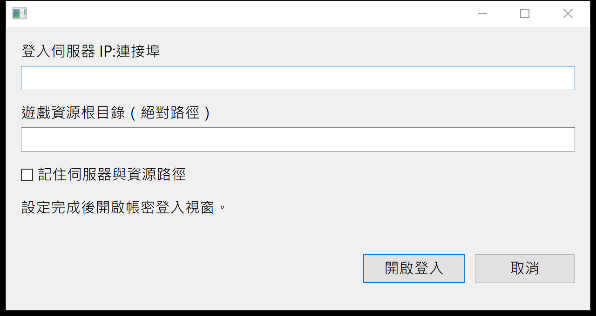
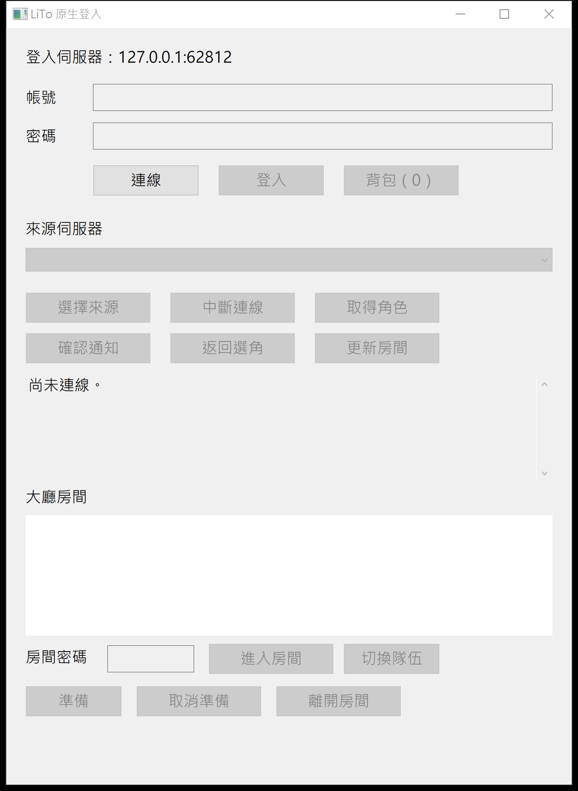
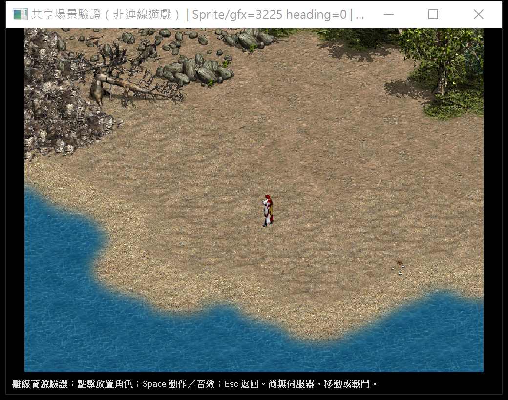

# 三個不連線畫面（#102 / T013）

本頁展示設定、登入及離線資源場景。這些畫面不代表連線遊戲或完整 V1 驗收完成。以下指令皆在本 repo 根目錄以 PowerShell 7 執行，資源只讀取外部既有客戶端，不能複製進 repo。

## 前置與建置

```powershell
(Get-Command pwsh).Source
$PSVersionTable.PSVersion
pwsh -NoProfile -File .\啟動現代客戶端.ps1 -BuildOnly
```

版本須為 7.0 以上。建置結果為 `LiTo381-Modern/target/current/x86_64-pc-windows-msvc/debug/LiToModern.exe`。每次啟動前記錄 `Get-Process LiToModern -ErrorAction SilentlyContinue`；只認領不在原清單內、且完整 Path 等於本輪建置 exe 的 PID。截圖後只關閉該 PID，並確認已退出。

## 設定畫面

```powershell
pwsh -NoProfile -File .\啟動現代客戶端.ps1 -ConfigureNative
```

預期：顯示原生啟動設定，可輸入端點及資源目錄。本次不輸入、不儲存、不繼續登入。

實際觀察：端點及資源路徑欄位皆空白，可清楚看到「記住伺服器與資源路徑」、「開啟登入」與「取消」。`IsWindowVisible=True`，沒有儲存設定。



## 登入畫面

```powershell
$listener = [Net.Sockets.TcpListener]::new([Net.IPAddress]::Loopback, 0)
$listener.Start()
$port = $listener.LocalEndpoint.Port
$listener.Stop()
if (@([Net.NetworkInformation.IPGlobalProperties]::GetIPGlobalProperties().GetActiveTcpListeners() | Where-Object Port -eq $port).Count) { throw '埠已被占用，請重新取得空埠' }
pwsh -NoProfile -File .\啟動現代客戶端.ps1 -NativeLoginEndpoint "127.0.0.1:$port"
```

預期：顯示登入視窗與未連線狀態。只使用剛取得並釋放的 loopback 空埠；不得按「連線」或輸入帳密。

實際觀察：顯示本輪取得後已釋放的 `127.0.0.1:62812`，帳號、密碼欄位皆空白，狀態為「尚未連線。」；其餘登入後功能為停用狀態。`IsWindowVisible=True`，沒有按連線。



## 離線場景

```powershell
pwsh -NoProfile -File .\啟動現代客戶端.ps1 -OfflineScene
```

資源根預設為 `D:\lineage開發\0-客戶端`；若設定 `LITO_CLIENT_ROOT` 則以該環境變數為準。本次使用預設資源根，未複製資源。等待 10～30 秒載入。

預期：即使啟動腳本使用 `-WindowStyle Hidden`，仍顯示離線地圖與角色資源。這是場景呈現驗證，未測移動、戰鬥、連線或音效互動。

實際觀察：等待 25 秒後，顯示岸邊、水面、石地、建物、植被與中央角色；標題顯示共享場景、`Sprite/gfx=3225 heading=0`，不是載入中或錯誤畫面。`IsWindowVisible=True`。未點擊角色、未按 Space，沒有觸發音效。



## 怎麼跑測試

在 repo 根目錄執行[本機測試套件](../維護工具/run-local-test-suite.ps1)。Windows PowerShell 5.1 與 PowerShell 7 都支援；以下日常指令不要求 PATH 有 pwsh：

```powershell
powershell -NoProfile -ExecutionPolicy Bypass -File 維護工具\run-local-test-suite.ps1
powershell -NoProfile -ExecutionPolicy Bypass -File 維護工具\run-local-test-suite.ps1 -Quick
```

完整版依序跑 check、lib Debug／Release、1 項 ignored lib 白名單與 76 項整合白名單；Quick 只跑 check 與 lib Debug。每步都列入總表，任一步失敗、0 tests 或結果缺失，整體結束碼就不是 0，但仍繼續其他步驟。

總表儲存於 `LiTo381-Modern/target/current/verification/local-test-suite/<stamp>/summary.txt`；同目錄有逐步 log。兩種 PowerShell 的實跑指令、原樣總表與結束碼見 [#101 驗收報告](reports/issue-101.md)。Debug／Release 各為 **1889 通過、0 失敗、575 ignored**，白名單分別為 **1／1、76／76**；ignored 與白名單外未執行項目不算通過，這也不代表 GUI／線上功能完成驗收。

本輪指令、可見性、PID、清理及限制見 [#102 報告](reports/issue-102.md)。
