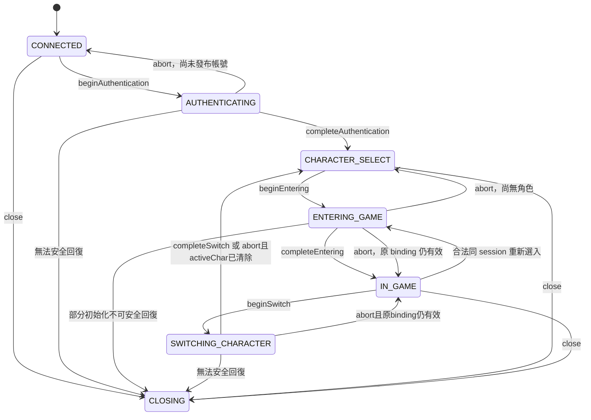
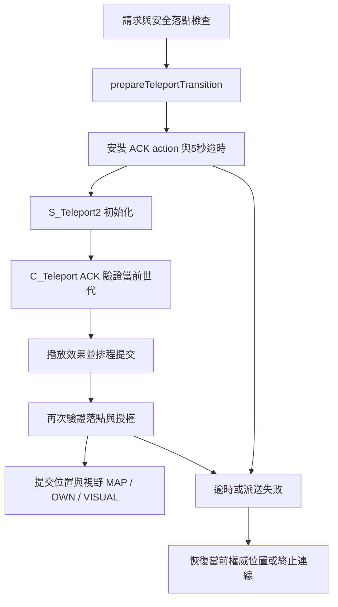

# 主伺服器規則與狀態機

Issue #261；2026-11-06。以下均為**已驗證：唯讀來源核對**；未啟動伺服器／遊戲、未連線正式 DB、未核對部署設定值或運行 JAR。封包格式見 [server-protocol.md](server-protocol.md)，本專案缺口見 [issue-261 報告](../reports/issue-261.md)。

本表的權威範圍是天堂主伺服器 `380C_TW / 13081901` 原始碼。LiTo E149 的登入、大廳、房間、轉服仍受 [既有契約](../PROTOCOL-CONTRACT.md) 約束；不能把下列主世界流程替換成 LiTo 流程。後續封包／狀態任務必須先查兩份 reference，再記錄適用 profile、來源方法、差異與驗證方式。

## 1. 來源定位

下列縮寫只為縮短表格；每一列的類別都應按此展開成 `1-伺服器/...` 相對路徑。

| 縮寫 | 目錄 |
|---|---|
| E | `1-伺服器/src/com/lineage/echo/` |
| C | `1-伺服器/src/com/lineage/server/clientpackets/` |
| S | `1-伺服器/src/com/lineage/server/serverpackets/` |
| M | `1-伺服器/src/com/lineage/server/model/` |
| U | `1-伺服器/src/com/lineage/server/utils/` |
| N | `1-伺服器/src/com/lineage/netty/` |

`C/C_MoveChar.java:start` 代表 `1-伺服器/src/com/lineage/server/clientpackets/C_MoveChar.java` 的 `start` 方法。常見入口簽章為 `void start(byte[] decrypt, ClientExecutor client)`；S 類別以建構子和 `getContent()` 為序列化入口。設定分支只記錄條件，不讀機密設定也不宣稱部署中的數值。

## 2. 登入、選角、切角與關閉

此狀態圖直接依 `E/SessionPhaseGate.java:beginAuthentication/beginEntering/beginSwitch` 及其 `Lease.completeAuthentication/completeEntering/completeSwitch/abort` 整理。

| ID | 規則／客戶端含義 | 來源類別與方法 |
|---|---|---|
| L01 | 新連線先收 18-byte 明文初始化，後續才是加密封包；C_VERSION=0x0E 回覆 S_ServerVersion=0x8B。版本 handler 沒有讀取 client 宣告版本欄位，不能由名稱推定有強制版本比對 | `N/handler/L1HandshakeHandler.java:channelActive`；`C/C_ServerVersion.java:start` |
| L02 | 帳密入口 C_AuthLogin 的 S,S；自動入口 C_AutoLogin 的 C,S,S，subcode=11 為控制 no-op。正常登入轉 `checkLogin`，驗證帳號、密碼、登入限制與重複登入後發布 account，再完成 authentication lease | `C/C_AuthLogin.java:start/checkLogin`；`C/C_AutoLogin.java:start`；`E/PacketHandler.java:handlePacket` |
| L03 | 成功先送 S_LoginResult；有公告送 S_CommonNews，C_CommonClick 後回 S_CharAmount 與每角 S_CharPacks。無公告可直接刷新選角清單；不能把「已認證」等同「已進世界」 | `C/C_AuthLogin.java:checkLogin`；`C/C_CommonClick.java:start/refreshAndSendCharacterList` |
| L04 | C_LoginToServer 使用角色名稱。服務端驗證帳號歸屬、舊角色 binding、初始化與背包權威；送 S_EnterGame 不代表已開放 GAME 操作，正常初始化全部完成後才 `completeEntering(pc)` | `C/C_LoginToServer.java:start` L221、233、459、716；`E/SessionPhaseGate.java:Lease.completeEntering` |
| L05 | 初始世界需角色狀態、地圖、自己物件、可見物件、背包、技能、buff 等資料。S_EnterGame 單包不能代替這些資料，也不是畫面完成 ACK | `C/C_LoginToServer.java:start`、`getFocus`、`items`、`skills`、`buff` |
| L06 | C_LoginToServerOK 的兩個 bytes 控制聊天頻道顯示／是否收密語；type=255 的組合碼亦會同時設定兩者。不得當選角成功或傳送 ACK | `C/C_LoginToServerOK.java:start` |
| L07 | policy：TRANSPORT 可在非 CLOSING 階段；AUTH 僅 CONNECTED；SELECTION 僅 CHARACTER_SELECT；ENTER_WORLD 在 CHARACTER_SELECT 或 IN_GAME；GAME 僅 IN_GAME；UNKNOWN 拒絕 | `E/SessionPacketPolicy.java:family/allows`；`E/SessionPhaseGate.java:allowsNow` |
| L08 | session permit 同時綁 account、active character、generation。排隊入場時可捕獲 GAME，但執行仍需進入 IN_GAME；舊角色／舊代 callback 不可重新授權新角色。10秒內違規達32次會進入關閉處理 | `E/SessionPhaseGate.java:capture/Permit.isCurrent/reject` |
| L09 | 切角需先擷取當前 binding、進 SWITCHING_CHARACTER、清掉 activeChar 後才回 CHARACTER_SELECT。失敗若不能安全回復則關閉，不以客戶端單方清畫面當完成 | `C/C_NewCharSelect.java:start`；`E/SessionPhaseGate.java:beginSwitch/Lease.completeSwitch/Lease.abort` |

## 3. 移動、面向與座標權威

| ID | 規則／客戶端含義 | 來源類別與方法 |
|---|---|---|
| M01 | C_MOVECHAR 讀 H(clientX), H(clientY), C(heading)，heading 範圍0..7。方向依序北、東北、東、東南、南、西南、西、西北；dx={0,1,1,1,0,-1,-1,-1}、dy={-1,-1,0,1,1,1,0,-1} | `C/C_MoveChar.java:start`、`HEADING_TABLE_X/Y` |
| M02 | client 基準座標只是同步觀測；伺服器使用自己的目前座標加方向求下一格。`observeClientMoveBase` 只可確認先前校正，不能推進世界位置 | `C/C_MoveChar.java:start` L224；`U/PcPositionSync.java:observeClientMoveBase` |
| M03 | 接受前檢查角色狀態、SPR action interval、移動節奏與共用 action timeline；拓樸以 server map 為準，方向牆、動態門不因 client 宣稱可走就放行 | `C/C_MoveChar.java:start` L198、326；`M/ClientActionTimeline.java` 的 reservation 方法 |
| M04 | 最後碰撞／格位檢查與 setXY 在同一落點 stripe 保護下執行；成功才提交 pacing、移動副作用與廣播。不能以送出 request 就立即覆寫權威狀態 | `C/C_MoveChar.java:start/commitAcceptedMovePacing/applyAcceptedMoveEffects` |
| M05 | S_MoveCharPacket 傳 sourceX/sourceY/heading，而非 destination；由同一次 committed movement snapshot 產生，送出前會驗證 location revision、map、target 仍一致 | `S/S_MoveCharPacket.java:S_MoveCharPacket(L1Character,MovementSnapshot)/isValidForWrite` |
| M06 | 拒絕移動時可回自己物件校正；較強校正還包括 unlock、map reset、視覺更新。同地圖 S_MapID 也可能是校正，不能一律當傳送／新世界世代 | `U/PcPositionSync.java:correctRejectedMove/publishCorrectionLocked`；`S/S_PcPositionCorrection.java:isValidForWrite`；`S/S_PcPositionMapReset.java:isValidForWrite` |
| M07 | 校正綁連線與座標 revision；後續合法移動／傳送可使舊校正失效。對不同對象的攻擊／施法還要通過位置與可見性 fence | `S/S_PcPositionCorrection.java:isValidForWrite`；`U/PlayerTargetPositionFence.java:isAuthorized`；`C/C_Attack.java:performAttack`；`C/C_UseSkill.java:performSkill` |

## 4. 攻擊、命中、傷害與施法

| ID | 規則／客戶端含義 | 來源類別與方法 |
|---|---|---|
| B01 | 物理請求只給 targetId 與座標，不帶可信 hit／damage。死亡、鬼魂、傳送、私店、隱身／隱身延遲、麻痺等有拒絕路徑；最終動作鎖內會重驗證，不因 ingress 初檢成功便執行 | `C/C_Attack.java:start/performAttack`；遠攻查 `C/C_AttackBow.java:start` |
| B02 | 攻擊與移動／技能共用時間線 reservation，並受動作間隔檢查；通過後才對目標呼叫 `onAction(pc)`。client 重送不代表每包都會落傷害 | `C/C_Attack.java:performAttack`；`M/ClientActionTimeline.java:tryReserveCombatAction/tryReserveSkillAction` |
| B03 | `calcHit` 檢查武器距離（非無限範圍以 weaponRange+1）、遠攻螢幕範圍、實體箭／飛刀與地形視線；魔法弓可例外免實體箭。PC/PC 與 PC/NPC 各有命中公式，不能用客戶端動畫碰撞決定命中 | `M/L1AttackPc.java:calcHit/calcPcHit/calcNpcHit` |
| B04 | 物理傷害由 weapon、屬性、buff 等經 `calcDamage/calcPcDamage/calcNpcDamage` 計算；`commit` 再分 PC/NPC 提交。飛行投射物 reservation 失敗可阻止提交；地形阻擋與戰鬥 MISS 有不同回饋 | `M/L1AttackPc.java:calcDamage/calcPcDamage/calcNpcDamage/commit/commitPc/commitNpc` |
| B05 | S_AttackPacketPc 的 damageWord 是 H，RO 寫 dmg、公版成功寫0x0A，未命中為0。不能拿公版0x0A直接扣10HP；targetId 還可能經受擊反應抑制表轉換。HP 顯示應依 HP／物件狀態更新 | `S/S_AttackPacketPc.java` 建構子；`S/ServerBasePacket.java:damageWordU16`；`1-伺服器/src/com/lineage/server/datatables/HitReactionSuppressTable.java:resolveTargetObjId` |
| B06 | C_USESKILL 的 skillId=(row<<3)+column+1；必須存在模板且角色學會。短 self/no-target 格式只含 row/column；長格式依 skillId 決定 D、HH、DHHS、HD、S 等，詳封包表 | `C/C_UseSkill.java:start`；`C/ClientPacketStructure.java:validateSkill` |
| B07 | target=none 時不將附帶 DWORD 當 World objId；召喚術51未戴召喚戒時仍消費 DWORD 但保持 targetId=0。116/118 要名稱非空、在線且同血盟；不可只檢查 wire 長度就宣告可施放 | `C/C_UseSkill.java:start/shouldResolveWorldObjectTarget` |
| B08 | `performSkill` 於 PlayerActionLock 內重驗 activeChar、連線、死亡、私店、傳送及 World 目標身分；`L1SkillUse` 完成目標／MP／材料檢查後取得 shared timeline，再發布接受的 cast 狀態 | `C/C_UseSkill.java:performSkill`；`M/skill/L1SkillUse.java:checkUseSkill/isNormalSkillUsable/isHPMPConsume/isItemConsume` |
| B09 | 執行時計算魔法傷害或機率、提交消耗、套效果、發圖示與動畫是不同階段。技能效果並非從 gfxId 倒推；施放動作也不能當命中／材料扣除收據 | `M/skill/L1SkillUse.java:runSkill/useConsume/sendGrfx/sendIcon`；`M/L1MagicPc.java:calcMagicDamage/calcProbabilityMagic` |
| B10 | 技能共用 reuse delay 與動作 reservation；材料真實消耗可能失敗，需依回覆更新 UI，不能先永久扣 client 背包再假定成功 | `M/skill/L1SkillUse.java:reserveCastLocksHeld/commitRequiredMaterialHeld/commitMaterialAndAcquireCastLocksHeld`；`M/skill/L1SkillDelay.java:tryReserveSkillUse` |

本表定位公式與提交入口，沒有宣稱一份靜態文件列完所有技能／裝備／資料表數值。特定技能、地圖與物品任務必須由上述方法追到其模板／executor；DB 實際內容仍待授權的離線 fixture 核對。

## 5. 道具、背包與裝備

| ID | 規則／客戶端含義 | 來源類別與方法 |
|---|---|---|
| I01 | 丟棄／拾取用 item instance objectId，count 經 Java int 語意處理且必須>0，不是 template ID。丟棄從自己的 inventory 取物件，目的 inventory 使用請求x/y與伺服器當前map | `C/C_DropItem.java:start`；`C/C_PickUpItem.java:start` |
| I02 | 非GM丟棄受全域 DORP_ITEM／白名單、可交易、時效限制；使用中寵物／娃娃、已裝備、封印也有阻擋。文件不推定當前部署是否開放丟棄 | `C/C_DropItem.java:start` |
| I03 | 拾取要當前玩家與 IN_GAME、非死亡／傳送／私店／隱身等；物件必須在 World 與對應 ground inventory 中，座標吻合、數量不超過、符合 owner 且距離≤3，再檢查容量重量 | `C/C_PickUpItem.java:start` |
| I04 | 拾取在 action/item 鎖內重驗 binding、connection generation 與物件，再 tradeItem；mutation quarantine／主提交成功但輔助失敗需保留真實結果，不能一律以 timeout 判回滾 | `C/C_PickUpItem.java:start` L134起；`M/L1Inventory.java:tradeItem` |
| I05 | C_ItemUSe 先以 objId 解析擁有物品，再依 use_type 檢查尾段；狀態／地圖、等級／職業、通用與道具延遲、剩餘次數／時效等分別決定能否使用 | `C/C_ItemUSe.java:useItemRequest`；`C/ClientPacketStructure.java:validateItemArguments` |
| I06 | 一般道具依 classname 轉 `ItemClass.item` 或 executor；武器／防具進 `useWeapon/useArmor` 並由 inventory.setEquipped 更新。裝備不是另一個萬用 equip opcode | `C/C_ItemUSe.java:useItemRequest/useItem/useWeapon/useArmor`；`M/L1PcInventory.java:setEquipped` |
| I07 | 弓箭 use_type=-2 為優先箭矢選擇切換，飛刀=-3 設定 sting；有對應 server message。不能把彈藥切換等同消耗一個道具 | `C/C_ItemUSe.java:useItemRequest` L515起 |
| I08 | 背包同步含 list/add/name/status/delete 等不同封包；status 長度可為0或另送長狀態。物品名稱、描述ID、useType、bless、count、status 應分開保存，不能只靠 viewName 判斷裝備或能力 | `S/S_InvList.java`、`S/S_AddItem.java`、`S/S_ItemStatus.java:shouldUseLongStatus/writeLongStatus`；`C/C_LoginToServer.java:items` |

## 6. 聊天、音效與特效

| ID | 規則／客戶端含義 | 來源類別與方法 |
|---|---|---|
| A01 | 一般 C_Chat 的 type 0一般、2大喊、4血盟、11隊伍、13聯盟、14聊天隊伍；廣播與密語另有 C_ChatGlobal/C_ChatWhisper。路由須依成員、範圍、拒絕名單／接收設定 | `C/C_Chat.java:start/chatType_0/chatType_2/chatType_4/chatType_11/chatType_13/chatType_14`；`C/C_ChatGlobal.java:start`；`C/C_ChatWhisper.java:start` |
| A02 | C_Chat 對 silence、area silence、poison silence、chat prohibited、CHAT_STOP 各有 gate；chatText.length()>52 拒絕。這是 Java 字元長度，不是任意 UTF-8 bytes 上限 | `C/C_Chat.java:start` L159–204 |
| A03 | S_Sound 是 repeat+sound；S_SkillSound 是 objId+gfxId（可選time）；S_EffectLocation 是x/y+gfxId；S_DoActionGFX 是 objId+actionId。音效ID、gfxID、actionID是不同語意，不能互用 | `S/S_Sound.java:buildPacket`；`S/S_SkillSound.java` 建構子；`S/S_EffectLocation.java` 建構子；`S/S_DoActionGFX.java` 建構子 |
| A04 | S_UseAttackSkill 可將來源actor設0以省略施法動作，仍攜帶目標、sequence、spellgfx與座標；部分變身會替換動作碼。接收器不能全域禁止 actor=0 | `S/S_UseAttackSkill.java:buildPacket` |
| A05 | 技能 gfx／buff icon 的觸發由技能處理器負責；可見回饋不表示命中，buff 時間需跟 server圖示／狀態一致。實際WAV與SPR資源映射及畫面同步未在本任務執行驗收 | `M/skill/L1SkillUse.java:sendGrfx/sendIcon`；`S/S_SkillHaste.java`、`S/S_SkillBrave.java`、`S/S_PacketBoxActiveSpells.java` 建構子 |

## 7. 換圖與傳送

以下是主伺服器**同連線世界傳送**，與 LiTo 的跨服務／房間接續不同。狀態名稱是本表對呼叫流程的說明；實際權威由 pc 的 teleport generation、connection generation、binding 與 pending ACK action 控制。

| ID | 規則／客戶端含義 | 來源類別與方法 |
|---|---|---|
| T01 | 一般 teleport 先確認 map 註冊、地圖限時與安全落點；`preparePcLanding` 先解一次，提交前再解，避免動畫期間門／佔位改變。unchecked 是明確不同入口，不能作一般client捷徑 | `M/L1Teleport.java:teleportInternal/teleportUnchecked`；`U/Teleportation.java:preparePcLanding/resolveSafeLanding/applyPcLocationWithSafeLanding` |
| T02 | 先 prepare transition、綁 connection與teleport generation，安裝 ACK action、成功安排逾時後才送 S_Teleport2。線上流程不得先送動畫／地圖，離線世界提交另有路徑 | `M/L1Teleport.java:startPcTeleport/beginNativeTeleport` |
| T03 | C_Teleport 不含目的地，只透過 `runIfTeleportClientAck` 接受當前待處理 ACK。ACK 表示 native 初始化就緒，並不代表動畫完成、落點已提交或跨服成功 | `C/C_Teleport.java:start`；`M/Instance/L1PcInstance.java:runIfTeleportClientAck`；`M/L1Teleport.java:playTeleportEffect` |
| T04 | 效果白／青／赤／綠SPR為169/2235/2236/2281，初始化後附加server delay為0/440/440/1120ms；白色動畫由native端持有。不可以統一固定delay猜提交時點 | `M/L1Teleport.java:EFFECT_SPR/EFFECT_TIME/playTeleportEffect` |
| T05 | 傳送技能可先發 TYPE_TELEPORT_UNLOCK 解除技能準備，再照常 S_Teleport2與真實ACK；該 unlock 不能被解讀為傳送已完成 | `M/L1Teleport.java:teleportFromTeleportSkill/beginNativeTeleport` |
| T06 | commit 重新驗證世代與授權；世界更新包括 S_MapID、自己的 S_OwnCharPack、可見物件與 S_CharVisualUpdate等。落點不是 S_Teleport2 的 map/id 自行推算結果 | `M/L1Teleport.java:commitTeleport/playEffectAndCommit`；`U/Teleportation.java:teleportation/teleportationWithResult` |
| T07 | 5秒初始化逾時透過 bounded session/world owner 處理；恢復使用**當前**權威座標，不重播原請求目的地；handoff無法接受或恢復失敗有終止路徑，不無限重試 | `M/L1Teleport.java:armTeleportClientAckTimeout/dispatchTeleportCommit/recoverCurrentTeleport/retireUndeliverableTeleport`；`U/Teleportation.java:abortPcTeleport` |
| T08 | 移動與入口也進共用傳送流程；入口ID、地圖條件由服務端解析。client只能提出操作，不能讓舊ACK、舊角色回呼使新角色換圖 | `C/C_EnterPortal.java:start`；`M/L1Teleport.java:teleportFromDungeon`；`E/SessionPhaseGate.java:Permit.isCurrent` |

## 8. 已驗證／推測／待驗證與下一棒

- **已驗證**：雙向 opcode、primitive讀寫寬度、346個C/S來源類別欄位索引、上述生命週期與規則來源、現有Rust對照。此處「已驗證」只指靜態來源事實。
- **推測**：若未新增協定 profile 就把此主伺服器 bytes 送進現有LiTo parser，會出現拒收或誤解碼；這由格式差異推導，沒有實際連線重現。
- **待驗證**：來源與運行JAR是否一致、部署編碼／ClientLogin等設定、DB模板內容、全部封包分支的動態golden bytes、GUI時序與WAV/SPR呈現。沒有把略過的測試記為通過。

下一棒：Claude 雲端審查兩種協定的範圍，依差異報告分派本機 code/test；本機執行者依特定封包做離線fixture與格式測試。新增主伺服器profile、改變E149綁定或直接互通屬後續任務，本次不改程式碼、不連正式服務。
