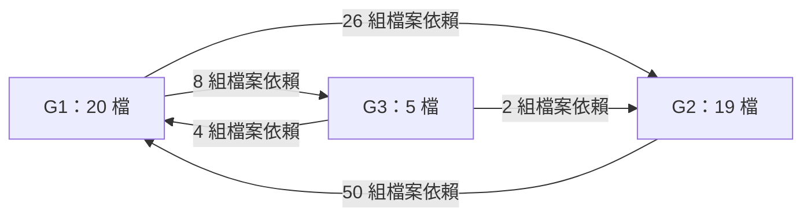

# Issue #41 — T003-R1：44 檔隔離候選靜態盤點

日期：2026-11-05。階段：resource。執行分支：`task/41`。狀態：本次靜態盤點完成；候選維持不套用。

## 做了什麼／已驗證

- 依 `docs/CANDIDATES.md` 一覽表順序取得 44 個唯一 overlay key，與 contract 的 `effective_overlay_paths`、`effective_overlay_files` 兩組 key 完全相同。分類仍為 30 Runtime／11 Rust QA／3 Java。
- 先從 evidence 的 `candidate` 欄讀取 contract 位置，再核對 contract 原始 bytes 的 SHA256；確認與 evidence 的 `candidate_sha256` 及 Issue 指定值皆一致後，才逐鍵讀取實體路徑。沒有使用「ready 目錄＋overlay key」公式。
- **44 檔一致、0 檔不一致、0 檔缺檔**。實體檔分散於 25 個候選目錄，僅 6 檔直接位於 ready 目錄。
- 25 檔有同名 `src/` 或 `tests/` 基準檔；指定 `git diff --no-index --numstat` 合計 **+8,050／−3,250**。另 19 檔無同名基準，候選行數共 **3,343** 行，未把它們當成新增行數混入 diff。25 檔候選的 SHA256 均不同於同名基準。
- 逐檔掃描 Rust 路徑、群組匯入、外部模組及 path 屬性，得到 **497 條「來源／行號／目標」引用、171 組不同檔案依賴**。同一行對同一目標重複引用只計一次；模組與 path 宣告各保留自己的行號。
- 比對基準是本 worktree 的實體檔；另唯讀比對原始專案同一路徑，44 列的存在情形及 25 個基準 SHA256 全部相同，沒有基準分歧。
- 只新增本報告。一次性腳本及中間資料放在 worktree 的 `scratch/` 並確認受 gitignore 排除；未變更 `docs/CANDIDATES.md`、`docs/REPORT.md` 或原始碼。

## 來源、雜湊與比對基準

下列 SHA256 均為本次讀取檔案 bytes 的實算值，不以歷史報告代替。路徑皆為本機絕對路徑。

- evidence：`D:\lineage開發\3-lito開發\lito重建版\驗證紀錄\current\native-E149-static2941-ready-development\20261024-211350-252315\evidence.json`
- evidence 實算 SHA256：`DE8F157B8952B7BC677A8CCB876328D4285DB4C3A12AEBE165C11ADE6E2D5508`
- evidence 本身未提供本任務指定的預期 SHA256；以上是來源識別值，不聲稱有上游 pin 比對。
- contract（由 evidence.candidate 取得）：`D:\lineage開發\3-lito開發\lito重建版\維護工具\candidates\native-E149-static2941-ready-20261024-210441-110315\contract.json`
- contract 實算 SHA256：`A5EAFAB92F673DEEE4D1E8EC4EEE39085B3B3C87C24C565DED2F0ACFBF831A97`
- evidence.candidate_sha256／Issue 預期：`A5EAFAB92F673DEEE4D1E8EC4EEE39085B3B3C87C24C565DED2F0ACFBF831A97`。判定：**一致**。
- 候選清單：`D:\lineage開發\3-lito開發\lito重建版\scratch\wt\task-41\docs\CANDIDATES.md`；實算 SHA256：`A337814FBA7D6F52A397C63BC7142962BB1F8563759F248FCA6BE8729E2D15DD`。
- 基準 worktree：`D:\lineage開發\3-lito開發\lito重建版\scratch\wt\task-41`；分析時 HEAD：`8d5a4061b0c153a7985544f66ed09c1a02719e2c`。
- 原始專案（唯讀候選來源與基準交叉核對）：`D:/lineage開發/3-lito開發/lito重建版`。
- Git：`git version 2.47.1.windows.1`；本機 core.autocrlf=false，diff.algorithm 未設定（Git 預設）。

## 怎麼驗證／統計規則

1. 以 UTF-8 讀取規範、清單、evidence 與 contract；SHA256 一律對未轉碼的原始 bytes 計算。先核對 contract，再取 `contract.effective_overlay_paths[key]` 與 `contract.effective_overlay_files[key]`。
2. 同名基準固定為 `<worktree>/<overlay key>`，包含 `tests/oracle/*.java`。對已存在的 25 檔逐一執行下列指令，將 exit code 0 視為無差異、1 視為有差異，其他值視為錯誤；本次 25 檔均回傳 1。

```text
git diff --no-index --numstat <worktree>/<overlay-key> <contract.effective_overlay_paths[key]>
```

3. 不加忽略空白或換行選項，也不正規化檔案。候選行數以 CRLF／LF／CR 為行界；末尾換行不額外算一行。無基準的列以「無」及「—」標示，僅記候選行數。
4. 依賴分析先略過註解、一般字串、raw 字串與字元常值，再解析 `super::`、`crate::`、群組 use、`mod`、`#[path]`；另納入整合測試的 `lito_modern::modern_lito::`。行號取目標模組名稱所在行；隱含父模組的 `super::*` 取該語句行。
5. 保留 inline mod 的上下文；兩個由 `native_login.rs` 的 path 宣告載入的 QA 檔，將其 `super::*` 正確連回 `native_login.rs`。同名的 runtime／整合測試 `native_skill_selection.rs` 以完整 overlay key 區分。
6. 只列 44 個 overlay key 之間的邊，不列檔案自身引用。保留所有 cfg 分支（包含測試碼），不展開巨集、不執行條件編譯、不追蹤一般函式呼叫或外部檔案的遞迴依賴。這是來源層級圖，不是編譯器驗證過的 runtime 圖。
7. 另以明示路徑掃描交叉檢查 417 個引用出現位置，確認皆已收錄；人工覆核任務指定行號、群組匯入樣本、兩個 QA 父模組與無出邊模組。報告產生後再核對 44 列、完整雜湊、依賴端點、必備五條引用及改檔範圍。

**換行注意**：第 3、13、35、42 列的基準分別有 2,512／256／134／96 個 CRLF，而候選為 LF；指定 diff 因此顯示整檔替換。表中忠實保留原始 numstat，這些數字不可直接解讀成語意修改量。

**執行環境**：一般命令執行器與 Node REPL 均在建立程序時回報 `setup refresh had errors`；經工具核准的命令執行途徑可用，本次透過該途徑完成靜態工作。未修改 runtime 設定，不宣稱已修復沙箱。

## 44 列檔案結果

「src 同名檔 SHA256」也涵蓋 tests／oracle，實體位置為上述 worktree 根目錄加 overlay key。所有實體候選路徑均直接取自 contract，未推導或替換。

| # | overlay key | 實體路徑 | 候選 SHA256 | 預期 SHA256 | 判定 | src 同名檔 SHA256（或無） | +行 | −行 | 候選行數 |
|---:|---|---|---|---|---|---|---:|---:|---:|
| 1 | `LiTo381-Modern/src/modern_lito/world_raster.rs` | `D:\lineage開發\3-lito開發\lito重建版\維護工具\candidates\native-keyboard-target-20261023-181848-311325\LiTo381-Modern\src\modern_lito\world_raster.rs` | `CC7053FB29872DB505A60E3F8A2B29F6413A5177EC1BBB3015F862D8A7AE04EF` | `CC7053FB29872DB505A60E3F8A2B29F6413A5177EC1BBB3015F862D8A7AE04EF` | 一致 | `71044B5BB712C5F732DC868D24D73E70673797E67E604C40C43D5567687506B2` | 64 | 0 | 973 |
| 2 | `LiTo381-Modern/src/modern_lito/native_world_scene.rs` | `D:\lineage開發\3-lito開發\lito重建版\維護工具\candidates\native-E149-static2941-ready-20261024-210441-110315\native_world_scene.rs` | `D3D258B1D0386CD39CC8B342E478442005129C56098B7259C6A0ADB499A72149` | `D3D258B1D0386CD39CC8B342E478442005129C56098B7259C6A0ADB499A72149` | 一致 | `3FD1BF18823E6D75918F568413A01949206900D6F49063DE82984747C6ECDF33` | 230 | 19 | 1622 |
| 3 | `LiTo381-Modern/src/modern_lito/native_login_window.rs` | `D:\lineage開發\3-lito開發\lito重建版\維護工具\candidates\native-E149-static2941-ready-20261024-210441-110315\native_login_window.rs` | `482DA12349561EE82B72DBA94A4F3E14DB177BAB371BE026F8E0C194D3591823` | `482DA12349561EE82B72DBA94A4F3E14DB177BAB371BE026F8E0C194D3591823` | 一致 | `17EA65A1EC0585E22DAAD54DFDE5EA564ACE7152FDFC77DE9894BE09BF7B510D` | 2840 | 2512 | 2840 |
| 4 | `LiTo381-Modern/src/modern_lito/native_skills.rs` | `D:\lineage開發\3-lito開發\lito重建版\維護工具\candidates\native-E149-hide97-venom98-draft-20261025-050000\LiTo381-Modern\src\modern_lito\native_skills.rs` | `35A49D0AF55984DDDBD287F87988C8D4864C12DCD1CD87F1452A6BC3DEB410B8` | `35A49D0AF55984DDDBD287F87988C8D4864C12DCD1CD87F1452A6BC3DEB410B8` | 一致 | `2FE342A84A78530E63038DE38F822D4DBAA335DCE903B36BF1598C704BC7EE60` | 995 | 7 | 1195 |
| 5 | `LiTo381-Modern/src/modern_lito/native_skill_selection.rs` | `D:\lineage開發\3-lito開發\lito重建版\維護工具\candidates\native-E149-hide97-venom98-draft-20261025-050000\LiTo381-Modern\src\modern_lito\native_skill_selection.rs` | `211E667A2F6BBD4B43B208C8E1236924C9A07773423D0E7EC5E4FD99AD50EC71` | `211E667A2F6BBD4B43B208C8E1236924C9A07773423D0E7EC5E4FD99AD50EC71` | 一致 | `29E5422061C3C94D548666FAE9AF0CD54F6E4C2D0137D542E294A8CFB827E2F5` | 93 | 3 | 315 |
| 6 | `LiTo381-Modern/src/modern_lito/native_login.rs` | `D:\lineage開發\3-lito開發\lito重建版\維護工具\candidates\native-E149-static2941-ready-20261024-210441-110315\native_login.rs` | `DBBF4B69EFC80979ECAA3D61E97238091DE38B31ECA642DA3F442EBDC142AFA9` | `DBBF4B69EFC80979ECAA3D61E97238091DE38B31ECA642DA3F442EBDC142AFA9` | 一致 | `C7734B8B13D7391B19395A221D1CA52FB14DB8DEF121F713C495BD38E67F09A6` | 290 | 46 | 3176 |
| 7 | `LiTo381-Modern/src/modern_lito/native_additional_finite_effects.rs` | `D:\lineage開發\3-lito開發\lito重建版\維護工具\candidates\native-E149-hide97-venom98-draft-20261025-050000\LiTo381-Modern\src\modern_lito\native_additional_finite_effects.rs` | `BEE452EE41F79EA6658E754946491FB1C383A5B997295D8508D0E2D5AA098E08` | `BEE452EE41F79EA6658E754946491FB1C383A5B997295D8508D0E2D5AA098E08` | 一致 | `7305CE9DC0A2E86714CEE96197F16785E67C173BD759E05B8926099A23088F86` | 229 | 9 | 280 |
| 8 | `LiTo381-Modern/src/modern_lito/native_selector_effects.rs` | `D:\lineage開發\3-lito開發\lito重建版\維護工具\candidates\native-E149-item-spells-20261024-015926-166432\LiTo381-Modern\src\modern_lito\native_selector_effects.rs` | `3FFA45D8D085B602470F94CB5A7D3B977EE47F453D04C6A3994682E898B6BD74` | `3FFA45D8D085B602470F94CB5A7D3B977EE47F453D04C6A3994682E898B6BD74` | 一致 | `A06C83A8E98904BD496D665D08F94499546D8F9D03B0F3269F1B9C06552AFFF0` | 23 | 2 | 197 |
| 9 | `LiTo381-Modern/src/modern_lito/light_arrow_effect.rs` | `D:\lineage開發\3-lito開發\lito重建版\維護工具\candidates\native-E149-freeze50-20261024-103539\LiTo381-Modern\src\modern_lito\light_arrow_effect.rs` | `4FB2AFFED6232D0A33ACEF26EDDB7CEAA9995CFB3EDE5C52BBA35512032CA058` | `4FB2AFFED6232D0A33ACEF26EDDB7CEAA9995CFB3EDE5C52BBA35512032CA058` | 一致 | `8F90FC57FD78B295942539415EF0BD09234ED0B9495E42C9A95637D35434F319` | 387 | 15 | 2003 |
| 10 | `LiTo381-Modern/src/modern_lito/native_attack_many.rs` | `D:\lineage開發\3-lito開發\lito重建版\維護工具\candidates\native-E149-freezing80-shock87-20261025-020000\LiTo381-Modern\src\modern_lito\native_attack_many.rs` | `47E56EF3E2FF4CC95DE05B59528AF90C784EA016B1E08C0111051C35C8CCE336` | `47E56EF3E2FF4CC95DE05B59528AF90C784EA016B1E08C0111051C35C8CCE336` | 一致 | `BAB57DC19267D1F116CFF1E651FF5FE5D476D29E50BE2F62BE6F0F44C6747130` | 585 | 19 | 685 |
| 11 | `LiTo381-Modern/src/modern_lito/native_class1.rs` | `D:\lineage開發\3-lito開發\lito重建版\維護工具\candidates\native-E149-sun46-weak47-20261024-100201\LiTo381-Modern\src\modern_lito\native_class1.rs` | `8D75C1EB14BFB6CA53D5DD1F59C2A4DAF59E76182DECECD121BFB2C1F999A2D8` | `8D75C1EB14BFB6CA53D5DD1F59C2A4DAF59E76182DECECD121BFB2C1F999A2D8` | 一致 | `D37147C2E1A52F9E62F0F77CF288FF619F107C1F81C79BE1AE9B37CC8256927B` | 212 | 13 | 354 |
| 12 | `LiTo381-Modern/src/modern_lito/native_world.rs` | `D:\lineage開發\3-lito開發\lito重建版\維護工具\candidates\native-E149-static2941-queue-20261024-203626-169258\native_world.rs` | `6BFC77AEFE661E867D672786DA123CE7B71A176D67ACD844F5F60D6487B6EC11` | `6BFC77AEFE661E867D672786DA123CE7B71A176D67ACD844F5F60D6487B6EC11` | 一致 | `3B63DFDC57EEE401BEC7411ADE57D0E3588E89AA8BB4552E40B3E3C7AC822D60` | 85 | 4 | 1134 |
| 13 | `LiTo381-Modern/src/modern_lito/native_audio_delivery.rs` | `D:\lineage開發\3-lito開發\lito重建版\維護工具\candidates\native-E149-S23-clock-origin-20261024-065915-163645\LiTo381-Modern\src\modern_lito\native_audio_delivery.rs` | `B1D07F831D94F81AF7DC43297E0AFEED1302E8037ACE9F9B7414FACCCA0EF868` | `B1D07F831D94F81AF7DC43297E0AFEED1302E8037ACE9F9B7414FACCCA0EF868` | 一致 | `16FBD4A2AB161D603D0D2A34D7B135374E868DDE990EF299637735B2EBEA282F` | 315 | 256 | 315 |
| 14 | `LiTo381-Modern/src/modern_lito/native_spell_projectiles.rs` | `D:\lineage開發\3-lito開發\lito重建版\維護工具\candidates\native-E149-freeze50-20261024-103539\LiTo381-Modern\src\modern_lito\native_spell_projectiles.rs` | `F33C2EA43464799EDFA737AF39EAC4709A142B8EEBD529289E4B0153BA99D5F4` | `F33C2EA43464799EDFA737AF39EAC4709A142B8EEBD529289E4B0153BA99D5F4` | 一致 | `B0EEE12B8ACEDB6B02D790BB16D14AE30BCFCC3378237A29171295E1BE5B5338` | 157 | 95 | 317 |
| 15 | `LiTo381-Modern/src/modern_lito/native_world_view.rs` | `D:\lineage開發\3-lito開發\lito重建版\維護工具\candidates\native-E149-static2941-ready-20261024-210441-110315\native_world_view.rs` | `7242F68C2C63A9699F68700E853E7A735CDF77AA1937E3C9D420162628434A7C` | `7242F68C2C63A9699F68700E853E7A735CDF77AA1937E3C9D420162628434A7C` | 一致 | `65C279D1F1E30BB3D00464CF876675FAD4D2178C18CFF3BB1DF21BC28BA522A6` | 63 | 4 | 470 |
| 16 | `LiTo381-Modern/src/modern_lito/native_skill_effects.rs` | `D:\lineage開發\3-lito開發\lito重建版\維護工具\candidates\native-E149-hide97-venom98-draft-20261025-050000\LiTo381-Modern\src\modern_lito\native_skill_effects.rs` | `F2B30AB6B096B1C569EFF022D710A068D0824F5589A4D124DC6DD2522137718C` | `F2B30AB6B096B1C569EFF022D710A068D0824F5589A4D124DC6DD2522137718C` | 一致 | `49E4A05F6713BCC1D8B267A33AAC1A6E439C9F8BE1164299E4C67EF2C53561F3` | 226 | 10 | 779 |
| 17 | `LiTo381-Modern/src/modern_lito/native_eruption45.rs` | `D:\lineage開發\3-lito開發\lito重建版\維護工具\candidates\native-E149-eruption45-core-20261024-085557\native_eruption45.rs` | `A784ADCD3CCB796D3CF3C22B72AD55C870CFA4FAB11CF5535DA356724727004D` | `A784ADCD3CCB796D3CF3C22B72AD55C870CFA4FAB11CF5535DA356724727004D` | 一致 | 無 | — | — | 380 |
| 18 | `LiTo381-Modern/src/modern_lito/native_eruption45_assets.rs` | `D:\lineage開發\3-lito開發\lito重建版\維護工具\candidates\native-E149-eruption45-core-20261024-085557\native_eruption45_assets.rs` | `EF4F34268BA3C0F022826C8AD96C868ACA3C7A2FCC8839B5155A69CF03D6ADC5` | `EF4F34268BA3C0F022826C8AD96C868ACA3C7A2FCC8839B5155A69CF03D6ADC5` | 一致 | 無 | — | — | 393 |
| 19 | `LiTo381-Modern/src/modern_lito/native_eruption45_scene.rs` | `D:\lineage開發\3-lito開發\lito重建版\維護工具\candidates\native-E149-sun46-weak47-20261024-100201\LiTo381-Modern\src\modern_lito\native_eruption45_scene.rs` | `11595B03280F7D3ABFE28B740903CF8A1FF508C83C3E12B0F015F0C9936AC24C` | `11595B03280F7D3ABFE28B740903CF8A1FF508C83C3E12B0F015F0C9936AC24C` | 一致 | 無 | — | — | 373 |
| 20 | `LiTo381-Modern/src/modern_lito/tower_assets.rs` | `D:\lineage開發\3-lito開發\lito重建版\維護工具\candidates\native-E149-hide97-static-draw-bridge-20261024-195610-910039\tower_assets.rs` | `0DB05545DBBC3CB3D708C0446135662C545F8D5F315C8C7E88FD5F58370B0216` | `0DB05545DBBC3CB3D708C0446135662C545F8D5F315C8C7E88FD5F58370B0216` | 一致 | `F6779F1DD95BEB463036470466C7ABD728E3963B6F2B6E6D162E3B1E3AA257C7` | 136 | 1 | 1494 |
| 21 | `LiTo381-Modern/src/modern_lito/native_blizzard59.rs` | `D:\lineage開發\3-lito開發\lito重建版\維護工具\candidates\native-E149-blizzard59-20261024-120000\LiTo381-Modern\src\modern_lito\native_blizzard59.rs` | `16A9B5562A5C926F46E576ED3C048462982A787F83D9919EAEB4397C73B68EF0` | `16A9B5562A5C926F46E576ED3C048462982A787F83D9919EAEB4397C73B68EF0` | 一致 | 無 | — | — | 111 |
| 22 | `LiTo381-Modern/src/modern_lito/native_resurrection61.rs` | `D:\lineage開發\3-lito開發\lito重建版\維護工具\candidates\native-E149-greater75-massslow76-20261025-014000\LiTo381-Modern\src\modern_lito\native_resurrection61.rs` | `5EBBDB307844F78C8B911674B80D466F0E77843918554EC040C254ABDB52D3BC` | `5EBBDB307844F78C8B911674B80D466F0E77843918554EC040C254ABDB52D3BC` | 一致 | 無 | — | — | 76 |
| 23 | `LiTo381-Modern/src/modern_lito/native_appearance27.rs` | `D:\lineage開發\3-lito開發\lito重建版\維護工具\candidates\native-E149-appearance27-binding-eq-20261024-144000\LiTo381-Modern\src\modern_lito\native_appearance27.rs` | `3133F4EEDEB8BD8A58F1A232508AD72E2B676F405C06ED6144E62AEEADF6EB01` | `3133F4EEDEB8BD8A58F1A232508AD72E2B676F405C06ED6144E62AEEADF6EB01` | 一致 | 無 | — | — | 184 |
| 24 | `LiTo381-Modern/src/modern_lito/native_world_animation.rs` | `D:\lineage開發\3-lito開發\lito重建版\維護工具\candidates\native-E149-appearance27-binding-callback-20261024-144000\LiTo381-Modern\src\modern_lito\native_world_animation.rs` | `8A402387BA198DBCBB259E7F132694BB39D1DC74A16EB93470DCFF2B15E0E9ED` | `8A402387BA198DBCBB259E7F132694BB39D1DC74A16EB93470DCFF2B15E0E9ED` | 一致 | `C05B262608E6218933630472FD34454F37C51DDCFBA3C293F418A739ED32218F` | 81 | 5 | 457 |
| 25 | `LiTo381-Modern/src/modern_lito/native_combat_animation.rs` | `D:\lineage開發\3-lito開發\lito重建版\維護工具\candidates\native-E149-appearance27-binding-20261024-144000\LiTo381-Modern\src\modern_lito\native_combat_animation.rs` | `CAB454514DB6FD800372871F5DB2C30A0098F1B3DFE2ED5430AABF690F718D08` | `CAB454514DB6FD800372871F5DB2C30A0098F1B3DFE2ED5430AABF690F718D08` | 一致 | `1D95ABB4B5D45CFF25655136017CD9A757112360B7E8BE4D4A2AA137569F8802` | 6 | 0 | 239 |
| 26 | `LiTo381-Modern/src/modern_lito/native_shape67.rs` | `D:\lineage開發\3-lito開發\lito重建版\維護工具\candidates\native-E149-shape67-protection68-20261024-154000\LiTo381-Modern\src\modern_lito\native_shape67.rs` | `4246ADD2067A66A819196DD408A6566FEF66998BBFD9B4D533FDE2C48A621AAA` | `4246ADD2067A66A819196DD408A6566FEF66998BBFD9B4D533FDE2C48A621AAA` | 一致 | 無 | — | — | 271 |
| 27 | `LiTo381-Modern/src/modern_lito/native_mass69.rs` | `D:\lineage開發\3-lito開發\lito重建版\維護工具\candidates\native-E149-mass69-input-20261025-004000\LiTo381-Modern\src\modern_lito\native_mass69.rs` | `B38B9CB1721EBB531CBBFF869256F73FD50EF8B03045E395257B4EEA19E41EE3` | `B38B9CB1721EBB531CBBFF869256F73FD50EF8B03045E395257B4EEA19E41EE3` | 一致 | 無 | — | — | 236 |
| 28 | `LiTo381-Modern/src/modern_lito/native_fire70.rs` | `D:\lineage開發\3-lito開發\lito重建版\維護工具\candidates\native-E149-mass69-fire70-20261025-001500\LiTo381-Modern\src\modern_lito\native_fire70.rs` | `CB64110098FC5138FC751C8D9AA0BA6DE2A8C166FFAB86E49ACD5F4161FA16DA` | `CB64110098FC5138FC751C8D9AA0BA6DE2A8C166FFAB86E49ACD5F4161FA16DA` | 一致 | 無 | — | — | 111 |
| 29 | `LiTo381-Modern/src/modern_lito/native_connection.rs` | `D:\lineage開發\3-lito開發\lito重建版\維護工具\candidates\native-E149-static2941-ready-20261024-210441-110315\native_connection.rs` | `E009B0BA0DD42877B3A9CA4504E7783A9004BCD9024254981572C0BB0E4D6ED1` | `E009B0BA0DD42877B3A9CA4504E7783A9004BCD9024254981572C0BB0E4D6ED1` | 一致 | `8314986BACE11C4DB774882D760125BFB10557C4D78C6922FCF8C1F8E053DF96` | 129 | 0 | 850 |
| 30 | `LiTo381-Modern/src/modern_lito/native_static2941.rs` | `D:\lineage開發\3-lito開發\lito重建版\維護工具\candidates\native-E149-static2941-ready-20261024-210441-110315\native_static2941.rs` | `CA74CEC1D688B76297E0EB2F6A680D2867250523654437425AE9F63FE54ABEF4` | `CA74CEC1D688B76297E0EB2F6A680D2867250523654437425AE9F63FE54ABEF4` | 一致 | 無 | — | — | 153 |
| 31 | `LiTo381-Modern/tests/native_skill_selection.rs` | `D:\lineage開發\3-lito開發\lito重建版\維護工具\candidates\native-keyboard-target-20261023-181848-311325\LiTo381-Modern\tests\native_skill_selection.rs` | `2CF174EDFB939A497718AA4698B3910DF2C0C42C14294EC959A1976C25B6382F` | `2CF174EDFB939A497718AA4698B3910DF2C0C42C14294EC959A1976C25B6382F` | 一致 | `FE6B27AC77CD367C6439788A81E53BE7353D6157DDF9A61E3CB3C2E5E3D69305` | 61 | 0 | 274 |
| 32 | `LiTo381-Modern/tests/native_blind.rs` | `D:\lineage開發\3-lito開發\lito重建版\維護工具\candidates\native-E149-item-spells-20261024-015926-166432\LiTo381-Modern\tests\native_blind.rs` | `2FC079DAD58E5EDBF06098E6FBBA985F9C5A2B409B5BCDC84A9258622FA5F797` | `2FC079DAD58E5EDBF06098E6FBBA985F9C5A2B409B5BCDC84A9258622FA5F797` | 一致 | 無 | — | — | 113 |
| 33 | `LiTo381-Modern/src/modern_lito/native_rental_return_tests.rs` | `D:\lineage開發\3-lito開發\lito重建版\維護工具\candidates\native-E149-recovery-observer-20261023-194101-605228\LiTo381-Modern\src\modern_lito\native_rental_return_tests.rs` | `50002F8DA5A3BF5B05B6AF3FA0CA3A65B5130812174036EC7A161917C6AE93FE` | `50002F8DA5A3BF5B05B6AF3FA0CA3A65B5130812174036EC7A161917C6AE93FE` | 一致 | `B6C809ACB177E7FBD21556E869FF958CCE081F64C6AFD3CA86646C71B0ACF2A5` | 124 | 0 | 297 |
| 34 | `LiTo381-Modern/src/modern_lito/native_teleport_controller_tests.rs` | `D:\lineage開發\3-lito開發\lito重建版\維護工具\candidates\native-E149-recovery-observer-20261023-194101-605228\LiTo381-Modern\src\modern_lito\native_teleport_controller_tests.rs` | `9D796FD60F89A7859995565A5E2D7369928DCEC7EE3B9EC7948D786DD0DF35BB` | `9D796FD60F89A7859995565A5E2D7369928DCEC7EE3B9EC7948D786DD0DF35BB` | 一致 | `994867632909121D1D0684F22DCA5BC08E1829F3D13444D3F75BF35DB3C25A0A` | 62 | 0 | 298 |
| 35 | `LiTo381-Modern/tests/native_teleport_failure.rs` | `D:\lineage開發\3-lito開發\lito重建版\維護工具\candidates\native-E149-morph-denial-20261024-010728-014199\LiTo381-Modern\tests\native_teleport_failure.rs` | `E44DF3301D395BE0E064927C187FE7D946D4A446BE7D34A5532A124D30D02C05` | `E44DF3301D395BE0E064927C187FE7D946D4A446BE7D34A5532A124D30D02C05` | 一致 | `B47D11DFBEFCD1523E8E0AE607C448039C24D441405E26EE8A11130776EBBCFA` | 198 | 134 | 198 |
| 36 | `LiTo381-Modern/tests/native_slow29.rs` | `D:\lineage開發\3-lito開發\lito重建版\維護工具\candidates\native-E149-item-spells-20261024-015926-166432\LiTo381-Modern\tests\native_slow29.rs` | `D49993AD50679074BB54433FE260853475C829C09B1C7AEC0ADA01ED079D1D42` | `D49993AD50679074BB54433FE260853475C829C09B1C7AEC0ADA01ED079D1D42` | 一致 | 無 | — | — | 89 |
| 37 | `LiTo381-Modern/tests/native_advance79.rs` | `D:\lineage開發\3-lito開發\lito重建版\維護工具\candidates\native-E149-item-spells-20261024-015926-166432\LiTo381-Modern\tests\native_advance79.rs` | `D9BB10BF11D28093E72E75DEA0EF5165D0427B60E046CBB7AB000137E7397B8D` | `D9BB10BF11D28093E72E75DEA0EF5165D0427B60E046CBB7AB000137E7397B8D` | 一致 | 無 | — | — | 68 |
| 38 | `LiTo381-Modern/tests/native_item_spells.rs` | `D:\lineage開發\3-lito開發\lito重建版\維護工具\candidates\native-E149-shadow107-20261024-025311-413076\LiTo381-Modern\tests\native_item_spells.rs` | `615CCB2BB50B2403189E374A6A726CD89845C8A803A106317852878F4B1673CD` | `615CCB2BB50B2403189E374A6A726CD89845C8A803A106317852878F4B1673CD` | 一致 | 無 | — | — | 64 |
| 39 | `LiTo381-Modern/tests/native_magical73.rs` | `D:\lineage開發\3-lito開發\lito重建版\維護工具\candidates\native-E149-magical73-20261024-022339-979384\LiTo381-Modern\tests\native_magical73.rs` | `8B6AAF6C3682BB9E67A11704FD1EF84A53CB425DC9B98559907B5E12BF9DC20D` | `8B6AAF6C3682BB9E67A11704FD1EF84A53CB425DC9B98559907B5E12BF9DC20D` | 一致 | 無 | — | — | 66 |
| 40 | `LiTo381-Modern/tests/native_shadow107.rs` | `D:\lineage開發\3-lito開發\lito重建版\維護工具\candidates\native-E149-shadow107-20261024-025311-413076\LiTo381-Modern\tests\native_shadow107.rs` | `E2D48E6738D43B70EF65982239FA26A6A3DDF87645A571F0A5465944A55EF8B6` | `E2D48E6738D43B70EF65982239FA26A6A3DDF87645A571F0A5465944A55EF8B6` | 一致 | 無 | — | — | 95 |
| 41 | `LiTo381-Modern/tests/native_object374448.rs` | `D:\lineage開發\3-lito開發\lito重建版\維護工具\candidates\native-E149-object374448-20261024-034418-995289\LiTo381-Modern\tests\native_object374448.rs` | `86785E6C4779C7E59F3ABA9538AD79C4B54BAD3E75A7341A280C6EE9C8E024B1` | `86785E6C4779C7E59F3ABA9538AD79C4B54BAD3E75A7341A280C6EE9C8E024B1` | 一致 | 無 | — | — | 105 |
| 42 | `LiTo381-Modern/tests/oracle/NativeTeleportFailureHarness.java` | `D:\lineage開發\3-lito開發\lito重建版\維護工具\candidates\native-E149-observer-stability-20261024-023412-802678\LiTo381-Modern\tests\oracle\NativeTeleportFailureHarness.java` | `235C0BB96D18ACB79326104FA14BA29723BE560079F1CB02323B4F2FF89204D0` | `235C0BB96D18ACB79326104FA14BA29723BE560079F1CB02323B4F2FF89204D0` | 一致 | `F67D61B8F6170E2E48C3FBF4445E8754E9132600824101D2A9C2A732DF0F69B3` | 459 | 96 | 459 |
| 43 | `LiTo381-Modern/tests/oracle/NativeRecoveryReadonlySnapshot.java` | `D:\lineage開發\3-lito開發\lito重建版\維護工具\candidates\native-E149-observer-stability-20261024-023412-802678\LiTo381-Modern\tests\oracle\NativeRecoveryReadonlySnapshot.java` | `A12CC6AC2E136FDE482F255DFBB66B71F112EB236036DE1ADA97A1E263727E74` | `A12CC6AC2E136FDE482F255DFBB66B71F112EB236036DE1ADA97A1E263727E74` | 一致 | 無 | — | — | 247 |
| 44 | `LiTo381-Modern/tests/oracle/NativeRecoveryProductionBootstrap.java` | `D:\lineage開發\3-lito開發\lito重建版\維護工具\candidates\native-E149-observer-stability-20261024-023412-802678\LiTo381-Modern\tests\oracle\NativeRecoveryProductionBootstrap.java` | `793064EFA911F12E536D217456E86360CD52B4CAECEC612807AF019DB707C6A1` | `793064EFA911F12E536D217456E86360CD52B4CAECEC612807AF019DB707C6A1` | 一致 | 無 | — | — | 208 |

## 依賴圖與研究分組

沿用 CANDIDATES 的研究分組：G1＝第 1–16、31、33–35 列；G2＝第 17–28、32、36–41 列；G3＝第 29–30、42–44 列。這不是套用順序；第 20、24、25 列雖有基準檔，依原研究分組仍列 G2。下圖及矩陣計算不同檔案對，不重複計入多個引用行。



| 來源 → 目標 | G1 | G2 | G3 |
|---|---:|---:|---:|
| G1 | 68 | 26 | 8 |
| G2 | 50 | 11 | 0 |
| G3 | 4 | 2 | 2 |

**已驗證的指定跨組引用**：

```text
LiTo381-Modern/src/modern_lito/native_login.rs:331 → LiTo381-Modern/src/modern_lito/native_static2941.rs
LiTo381-Modern/src/modern_lito/native_attack_many.rs:198 → LiTo381-Modern/src/modern_lito/native_blizzard59.rs
LiTo381-Modern/src/modern_lito/native_attack_many.rs:198 → LiTo381-Modern/src/modern_lito/native_fire70.rs
LiTo381-Modern/src/modern_lito/native_attack_many.rs:204 → LiTo381-Modern/src/modern_lito/native_blizzard59.rs
LiTo381-Modern/src/modern_lito/native_attack_many.rs:204 → LiTo381-Modern/src/modern_lito/native_fire70.rs
```

第 198、204 行各自同時引用 fire70 與 blizzard59，並非兩行各只引用其中之一。另第 204 行引用 light_arrow_effect，已列入完整清單。

**直接依賴 G3 的 G1／G2 檔案**（不包含 G3 自身）：

- `LiTo381-Modern/src/modern_lito/native_world_scene.rs` → `LiTo381-Modern/src/modern_lito/native_static2941.rs`。
- `LiTo381-Modern/src/modern_lito/native_login_window.rs` → `LiTo381-Modern/src/modern_lito/native_connection.rs`。
- `LiTo381-Modern/src/modern_lito/native_login.rs` → `LiTo381-Modern/src/modern_lito/native_connection.rs`、`LiTo381-Modern/src/modern_lito/native_static2941.rs`。
- `LiTo381-Modern/src/modern_lito/native_world.rs` → `LiTo381-Modern/src/modern_lito/native_connection.rs`、`LiTo381-Modern/src/modern_lito/native_static2941.rs`。
- `LiTo381-Modern/src/modern_lito/native_world_view.rs` → `LiTo381-Modern/src/modern_lito/native_static2941.rs`。
- `LiTo381-Modern/tests/native_teleport_failure.rs` → `LiTo381-Modern/src/modern_lito/native_connection.rs`。

**循環分量（來源層級，含 cfg(test)）**：

- 3 檔強連通分量：`#7 LiTo381-Modern/src/modern_lito/native_additional_finite_effects.rs`、`#8 LiTo381-Modern/src/modern_lito/native_selector_effects.rs`、`#20 LiTo381-Modern/src/modern_lito/tower_assets.rs`。
- 23 檔強連通分量：`#2 LiTo381-Modern/src/modern_lito/native_world_scene.rs`、`#4 LiTo381-Modern/src/modern_lito/native_skills.rs`、`#5 LiTo381-Modern/src/modern_lito/native_skill_selection.rs`、`#6 LiTo381-Modern/src/modern_lito/native_login.rs`、`#10 LiTo381-Modern/src/modern_lito/native_attack_many.rs`、`#11 LiTo381-Modern/src/modern_lito/native_class1.rs`、`#12 LiTo381-Modern/src/modern_lito/native_world.rs`、`#13 LiTo381-Modern/src/modern_lito/native_audio_delivery.rs`、`#14 LiTo381-Modern/src/modern_lito/native_spell_projectiles.rs`、`#16 LiTo381-Modern/src/modern_lito/native_skill_effects.rs`、`#19 LiTo381-Modern/src/modern_lito/native_eruption45_scene.rs`、`#21 LiTo381-Modern/src/modern_lito/native_blizzard59.rs`、`#22 LiTo381-Modern/src/modern_lito/native_resurrection61.rs`、`#23 LiTo381-Modern/src/modern_lito/native_appearance27.rs`、`#24 LiTo381-Modern/src/modern_lito/native_world_animation.rs`、`#25 LiTo381-Modern/src/modern_lito/native_combat_animation.rs`、`#26 LiTo381-Modern/src/modern_lito/native_shape67.rs`、`#27 LiTo381-Modern/src/modern_lito/native_mass69.rs`、`#28 LiTo381-Modern/src/modern_lito/native_fire70.rs`、`#29 LiTo381-Modern/src/modern_lito/native_connection.rs`、`#30 LiTo381-Modern/src/modern_lito/native_static2941.rs`、`#33 LiTo381-Modern/src/modern_lito/native_rental_return_tests.rs`、`#34 LiTo381-Modern/src/modern_lito/native_teleport_controller_tests.rs`。

## 六個外部模組／path 宣告

下表將字面 path 依 overlay 的邏輯來源目錄辨認；未把 ready 檔案旁的相對路徑當成另一份實體候選，也未遞迴載入非 overlay 檔案。inline mod 只用來判定上下文，不另造 overlay key。

| 來源 key | path 行 | mod 行 | path 字面值 | 模組名 | overlay 目標 |
|---|---:|---:|---|---|---|
| `LiTo381-Modern/src/modern_lito/native_login_window.rs` | 26 | 27 | `native_rental_window.rs` | `rental` | 非 44 檔 overlay；不列候選間依賴邊 |
| `LiTo381-Modern/src/modern_lito/native_login.rs` | 11 | 12 | `native_rental_return_tests.rs` | `rental_return_tests` | `LiTo381-Modern/src/modern_lito/native_rental_return_tests.rs` |
| `LiTo381-Modern/src/modern_lito/native_login.rs` | 14 | 15 | `native_battle_withdrawal_tests.rs` | `battle_withdrawal_tests` | 非 44 檔 overlay；不列候選間依賴邊 |
| `LiTo381-Modern/src/modern_lito/native_login.rs` | 17 | 18 | `native_return_server_negative_tests.rs` | `return_server_negative_tests` | 非 44 檔 overlay；不列候選間依賴邊 |
| `LiTo381-Modern/src/modern_lito/native_login.rs` | 2395 | 2396 | `native_teleport_controller_tests.rs` | `teleport_wire_tests` | `LiTo381-Modern/src/modern_lito/native_teleport_controller_tests.rs` |
| `LiTo381-Modern/src/modern_lito/native_login.rs` | 3110 | 3111 | `native_pending_join_departure_tests.rs` | `pending_join_departure_tests` | 非 44 檔 overlay；不列候選間依賴邊 |

## 完整依賴邊清單

以下每一節對應一個候選檔；格式為「來源 key:行號 → 目標 key」，括號標示引用形式。相同行號同一目標去重；無邊表示本次範圍內沒有對其他 overlay key 的引用，不代表檔案沒有其他相依。

### 1. `LiTo381-Modern/src/modern_lito/world_raster.rs`

未發現對其他 overlay key 的引用。

### 2. `LiTo381-Modern/src/modern_lito/native_world_scene.rs`

```text
LiTo381-Modern/src/modern_lito/native_world_scene.rs:6 → LiTo381-Modern/src/modern_lito/native_world.rs （super::）
LiTo381-Modern/src/modern_lito/native_world_scene.rs:22 → LiTo381-Modern/src/modern_lito/native_static2941.rs （super::）
LiTo381-Modern/src/modern_lito/native_world_scene.rs:26 → LiTo381-Modern/src/modern_lito/world_raster.rs （super::）
LiTo381-Modern/src/modern_lito/native_world_scene.rs:69 → LiTo381-Modern/src/modern_lito/native_skill_selection.rs （super::）
LiTo381-Modern/src/modern_lito/native_world_scene.rs:71 → LiTo381-Modern/src/modern_lito/native_skill_selection.rs （super::）
LiTo381-Modern/src/modern_lito/native_world_scene.rs:75 → LiTo381-Modern/src/modern_lito/native_skill_selection.rs （super::）
LiTo381-Modern/src/modern_lito/native_world_scene.rs:77 → LiTo381-Modern/src/modern_lito/native_skill_selection.rs （super::）
LiTo381-Modern/src/modern_lito/native_world_scene.rs:78 → LiTo381-Modern/src/modern_lito/native_skill_selection.rs （super::）
LiTo381-Modern/src/modern_lito/native_world_scene.rs:86 → LiTo381-Modern/src/modern_lito/world_raster.rs （super::）
LiTo381-Modern/src/modern_lito/native_world_scene.rs:109 → LiTo381-Modern/src/modern_lito/native_world.rs （super::）
LiTo381-Modern/src/modern_lito/native_world_scene.rs:124 → LiTo381-Modern/src/modern_lito/native_static2941.rs （super::）
LiTo381-Modern/src/modern_lito/native_world_scene.rs:125 → LiTo381-Modern/src/modern_lito/native_static2941.rs （super::）
LiTo381-Modern/src/modern_lito/native_world_scene.rs:126 → LiTo381-Modern/src/modern_lito/native_world.rs （super::）
LiTo381-Modern/src/modern_lito/native_world_scene.rs:128 → LiTo381-Modern/src/modern_lito/world_raster.rs （super::）
LiTo381-Modern/src/modern_lito/native_world_scene.rs:130 → LiTo381-Modern/src/modern_lito/native_audio_delivery.rs （super::）
LiTo381-Modern/src/modern_lito/native_world_scene.rs:131 → LiTo381-Modern/src/modern_lito/native_audio_delivery.rs （super::）
LiTo381-Modern/src/modern_lito/native_world_scene.rs:274 → LiTo381-Modern/src/modern_lito/native_world_animation.rs （super::）
LiTo381-Modern/src/modern_lito/native_world_scene.rs:371 → LiTo381-Modern/src/modern_lito/native_static2941.rs （super::）
LiTo381-Modern/src/modern_lito/native_world_scene.rs:373 → LiTo381-Modern/src/modern_lito/native_world_animation.rs （super::）
LiTo381-Modern/src/modern_lito/native_world_scene.rs:374 → LiTo381-Modern/src/modern_lito/native_attack_many.rs （super::）
LiTo381-Modern/src/modern_lito/native_world_scene.rs:374 → LiTo381-Modern/src/modern_lito/native_class1.rs （super::）
LiTo381-Modern/src/modern_lito/native_world_scene.rs:374 → LiTo381-Modern/src/modern_lito/native_skill_effects.rs （super::）
LiTo381-Modern/src/modern_lito/native_world_scene.rs:374 → LiTo381-Modern/src/modern_lito/native_spell_projectiles.rs （super::）
LiTo381-Modern/src/modern_lito/native_world_scene.rs:415 → LiTo381-Modern/src/modern_lito/native_static2941.rs （super::）
LiTo381-Modern/src/modern_lito/native_world_scene.rs:417 → LiTo381-Modern/src/modern_lito/native_world_animation.rs （super::）
LiTo381-Modern/src/modern_lito/native_world_scene.rs:419 → LiTo381-Modern/src/modern_lito/native_skill_effects.rs （super::）
LiTo381-Modern/src/modern_lito/native_world_scene.rs:420 → LiTo381-Modern/src/modern_lito/native_skill_effects.rs （super::）
LiTo381-Modern/src/modern_lito/native_world_scene.rs:421 → LiTo381-Modern/src/modern_lito/native_skill_effects.rs （super::）
LiTo381-Modern/src/modern_lito/native_world_scene.rs:422 → LiTo381-Modern/src/modern_lito/native_skill_effects.rs （super::）
LiTo381-Modern/src/modern_lito/native_world_scene.rs:425 → LiTo381-Modern/src/modern_lito/native_spell_projectiles.rs （super::）
LiTo381-Modern/src/modern_lito/native_world_scene.rs:426 → LiTo381-Modern/src/modern_lito/native_class1.rs （super::）
LiTo381-Modern/src/modern_lito/native_world_scene.rs:431 → LiTo381-Modern/src/modern_lito/native_attack_many.rs （super::）
LiTo381-Modern/src/modern_lito/native_world_scene.rs:736 → LiTo381-Modern/src/modern_lito/native_skill_effects.rs （super::）
LiTo381-Modern/src/modern_lito/native_world_scene.rs:737 → LiTo381-Modern/src/modern_lito/native_skill_effects.rs （super::）
LiTo381-Modern/src/modern_lito/native_world_scene.rs:738 → LiTo381-Modern/src/modern_lito/native_skill_effects.rs （super::）
LiTo381-Modern/src/modern_lito/native_world_scene.rs:1379 → LiTo381-Modern/src/modern_lito/native_audio_delivery.rs （super::）
LiTo381-Modern/src/modern_lito/native_world_scene.rs:1470 → LiTo381-Modern/src/modern_lito/native_skill_selection.rs （super::）
LiTo381-Modern/src/modern_lito/native_world_scene.rs:1470 → LiTo381-Modern/src/modern_lito/native_world.rs （super::）
LiTo381-Modern/src/modern_lito/native_world_scene.rs:1470 → LiTo381-Modern/src/modern_lito/world_raster.rs （super::）
LiTo381-Modern/src/modern_lito/native_world_scene.rs:1474 → LiTo381-Modern/src/modern_lito/native_login.rs （super::）
LiTo381-Modern/src/modern_lito/native_world_scene.rs:1475 → LiTo381-Modern/src/modern_lito/world_raster.rs （super::）
LiTo381-Modern/src/modern_lito/native_world_scene.rs:1498 → LiTo381-Modern/src/modern_lito/native_skill_effects.rs （super::）
LiTo381-Modern/src/modern_lito/native_world_scene.rs:1500 → LiTo381-Modern/src/modern_lito/native_attack_many.rs （super::）
LiTo381-Modern/src/modern_lito/native_world_scene.rs:1500 → LiTo381-Modern/src/modern_lito/native_class1.rs （super::）
LiTo381-Modern/src/modern_lito/native_world_scene.rs:1500 → LiTo381-Modern/src/modern_lito/native_spell_projectiles.rs （super::）
LiTo381-Modern/src/modern_lito/native_world_scene.rs:1500 → LiTo381-Modern/src/modern_lito/native_world_animation.rs （super::）
LiTo381-Modern/src/modern_lito/native_world_scene.rs:1510 → LiTo381-Modern/src/modern_lito/native_audio_delivery.rs （crate::）
LiTo381-Modern/src/modern_lito/native_world_scene.rs:1510 → LiTo381-Modern/src/modern_lito/native_combat_animation.rs （crate::）
LiTo381-Modern/src/modern_lito/native_world_scene.rs:1510 → LiTo381-Modern/src/modern_lito/native_world.rs （crate::）
LiTo381-Modern/src/modern_lito/native_world_scene.rs:1510 → LiTo381-Modern/src/modern_lito/tower_assets.rs （crate::）
LiTo381-Modern/src/modern_lito/native_world_scene.rs:1595 → LiTo381-Modern/src/modern_lito/native_login.rs （crate::）
LiTo381-Modern/src/modern_lito/native_world_scene.rs:1598 → LiTo381-Modern/src/modern_lito/native_audio_delivery.rs （crate::）
LiTo381-Modern/src/modern_lito/native_world_scene.rs:1621 → LiTo381-Modern/src/modern_lito/native_audio_delivery.rs （super::）
```

### 3. `LiTo381-Modern/src/modern_lito/native_login_window.rs`

```text
LiTo381-Modern/src/modern_lito/native_login_window.rs:3 → LiTo381-Modern/src/modern_lito/native_connection.rs （super::）
LiTo381-Modern/src/modern_lito/native_login_window.rs:4 → LiTo381-Modern/src/modern_lito/native_login.rs （super::）
LiTo381-Modern/src/modern_lito/native_login_window.rs:87 → LiTo381-Modern/src/modern_lito/native_mass69.rs （super::）
LiTo381-Modern/src/modern_lito/native_login_window.rs:89 → LiTo381-Modern/src/modern_lito/native_mass69.rs （super::）
LiTo381-Modern/src/modern_lito/native_login_window.rs:90 → LiTo381-Modern/src/modern_lito/native_mass69.rs （super::）
LiTo381-Modern/src/modern_lito/native_login_window.rs:91 → LiTo381-Modern/src/modern_lito/native_shape67.rs （super::）
LiTo381-Modern/src/modern_lito/native_login_window.rs:93 → LiTo381-Modern/src/modern_lito/native_resurrection61.rs （super::）
LiTo381-Modern/src/modern_lito/native_login_window.rs:110 → LiTo381-Modern/src/modern_lito/native_skills.rs （super::）
LiTo381-Modern/src/modern_lito/native_login_window.rs:111 → LiTo381-Modern/src/modern_lito/native_skills.rs （super::）
LiTo381-Modern/src/modern_lito/native_login_window.rs:113 → LiTo381-Modern/src/modern_lito/native_skill_selection.rs （super::）
LiTo381-Modern/src/modern_lito/native_login_window.rs:114 → LiTo381-Modern/src/modern_lito/native_skill_selection.rs （super::）
LiTo381-Modern/src/modern_lito/native_login_window.rs:115 → LiTo381-Modern/src/modern_lito/native_skill_selection.rs （super::）
LiTo381-Modern/src/modern_lito/native_login_window.rs:117 → LiTo381-Modern/src/modern_lito/native_world_scene.rs （super::）
LiTo381-Modern/src/modern_lito/native_login_window.rs:119 → LiTo381-Modern/src/modern_lito/native_audio_delivery.rs （super::）
LiTo381-Modern/src/modern_lito/native_login_window.rs:131 → LiTo381-Modern/src/modern_lito/native_world_view.rs （super::）
LiTo381-Modern/src/modern_lito/native_login_window.rs:852 → LiTo381-Modern/src/modern_lito/native_audio_delivery.rs （super::）
LiTo381-Modern/src/modern_lito/native_login_window.rs:861 → LiTo381-Modern/src/modern_lito/native_audio_delivery.rs （super::）
LiTo381-Modern/src/modern_lito/native_login_window.rs:872 → LiTo381-Modern/src/modern_lito/native_skills.rs （super::）
LiTo381-Modern/src/modern_lito/native_login_window.rs:876 → LiTo381-Modern/src/modern_lito/native_skills.rs （super::）
LiTo381-Modern/src/modern_lito/native_login_window.rs:883 → LiTo381-Modern/src/modern_lito/native_skills.rs （super::）
LiTo381-Modern/src/modern_lito/native_login_window.rs:899 → LiTo381-Modern/src/modern_lito/native_skill_selection.rs （super::）
LiTo381-Modern/src/modern_lito/native_login_window.rs:1127 → LiTo381-Modern/src/modern_lito/native_skills.rs （super::）
LiTo381-Modern/src/modern_lito/native_login_window.rs:1133 → LiTo381-Modern/src/modern_lito/native_skills.rs （super::）
LiTo381-Modern/src/modern_lito/native_login_window.rs:1140 → LiTo381-Modern/src/modern_lito/native_skills.rs （super::）
LiTo381-Modern/src/modern_lito/native_login_window.rs:1141 → LiTo381-Modern/src/modern_lito/native_skills.rs （super::）
LiTo381-Modern/src/modern_lito/native_login_window.rs:1144 → LiTo381-Modern/src/modern_lito/native_skills.rs （super::）
LiTo381-Modern/src/modern_lito/native_login_window.rs:1148 → LiTo381-Modern/src/modern_lito/native_skills.rs （super::）
LiTo381-Modern/src/modern_lito/native_login_window.rs:1196 → LiTo381-Modern/src/modern_lito/native_skills.rs （super::）
LiTo381-Modern/src/modern_lito/native_login_window.rs:1323 → LiTo381-Modern/src/modern_lito/native_shape67.rs （super::）
LiTo381-Modern/src/modern_lito/native_login_window.rs:2323 → LiTo381-Modern/src/modern_lito/native_skill_selection.rs （super::）
LiTo381-Modern/src/modern_lito/native_login_window.rs:2328 → LiTo381-Modern/src/modern_lito/native_skill_selection.rs （super::）
LiTo381-Modern/src/modern_lito/native_login_window.rs:2356 → LiTo381-Modern/src/modern_lito/native_shape67.rs （super::）
LiTo381-Modern/src/modern_lito/native_login_window.rs:2365 → LiTo381-Modern/src/modern_lito/native_shape67.rs （super::）
LiTo381-Modern/src/modern_lito/native_login_window.rs:2406 → LiTo381-Modern/src/modern_lito/native_skills.rs （super::）
LiTo381-Modern/src/modern_lito/native_login_window.rs:2408 → LiTo381-Modern/src/modern_lito/native_skills.rs （super::）
LiTo381-Modern/src/modern_lito/native_login_window.rs:2679 → LiTo381-Modern/src/modern_lito/native_shape67.rs （super::）
```

### 4. `LiTo381-Modern/src/modern_lito/native_skills.rs`

```text
LiTo381-Modern/src/modern_lito/native_skills.rs:2 → LiTo381-Modern/src/modern_lito/native_world.rs （super::）
LiTo381-Modern/src/modern_lito/native_skills.rs:48 → LiTo381-Modern/src/modern_lito/native_login.rs （super::）
LiTo381-Modern/src/modern_lito/native_skills.rs:48 → LiTo381-Modern/src/modern_lito/native_mass69.rs （super::）
LiTo381-Modern/src/modern_lito/native_skills.rs:58 → LiTo381-Modern/src/modern_lito/native_login.rs （super::）
LiTo381-Modern/src/modern_lito/native_skills.rs:65 → LiTo381-Modern/src/modern_lito/native_login.rs （super::）
LiTo381-Modern/src/modern_lito/native_skills.rs:76 → LiTo381-Modern/src/modern_lito/native_login.rs （super::）
LiTo381-Modern/src/modern_lito/native_skills.rs:300 → LiTo381-Modern/src/modern_lito/native_skill_selection.rs （super::）
LiTo381-Modern/src/modern_lito/native_skills.rs:303 → LiTo381-Modern/src/modern_lito/native_login.rs （super::）
LiTo381-Modern/src/modern_lito/native_skills.rs:383 → LiTo381-Modern/src/modern_lito/native_skill_selection.rs （super::）
LiTo381-Modern/src/modern_lito/native_skills.rs:386 → LiTo381-Modern/src/modern_lito/native_login.rs （super::）
LiTo381-Modern/src/modern_lito/native_skills.rs:438 → LiTo381-Modern/src/modern_lito/native_skill_effects.rs （super::）
LiTo381-Modern/src/modern_lito/native_skills.rs:439 → LiTo381-Modern/src/modern_lito/native_additional_finite_effects.rs （super::）
LiTo381-Modern/src/modern_lito/native_skills.rs:439 → LiTo381-Modern/src/modern_lito/native_skill_effects.rs （super::）
LiTo381-Modern/src/modern_lito/native_skills.rs:453 → LiTo381-Modern/src/modern_lito/native_skill_selection.rs （super::）
LiTo381-Modern/src/modern_lito/native_skills.rs:456 → LiTo381-Modern/src/modern_lito/native_login.rs （super::）
LiTo381-Modern/src/modern_lito/native_skills.rs:501 → LiTo381-Modern/src/modern_lito/native_additional_finite_effects.rs （super::）
LiTo381-Modern/src/modern_lito/native_skills.rs:501 → LiTo381-Modern/src/modern_lito/native_skill_effects.rs （super::）
LiTo381-Modern/src/modern_lito/native_skills.rs:512 → LiTo381-Modern/src/modern_lito/native_skill_selection.rs （super::）
LiTo381-Modern/src/modern_lito/native_skills.rs:515 → LiTo381-Modern/src/modern_lito/native_login.rs （super::）
LiTo381-Modern/src/modern_lito/native_skills.rs:559 → LiTo381-Modern/src/modern_lito/native_additional_finite_effects.rs （super::）
LiTo381-Modern/src/modern_lito/native_skills.rs:559 → LiTo381-Modern/src/modern_lito/native_skill_effects.rs （super::）
LiTo381-Modern/src/modern_lito/native_skills.rs:568 → LiTo381-Modern/src/modern_lito/native_skill_selection.rs （super::）
LiTo381-Modern/src/modern_lito/native_skills.rs:571 → LiTo381-Modern/src/modern_lito/native_login.rs （super::）
LiTo381-Modern/src/modern_lito/native_skills.rs:666 → LiTo381-Modern/src/modern_lito/native_spell_projectiles.rs （super::）
LiTo381-Modern/src/modern_lito/native_skills.rs:668 → LiTo381-Modern/src/modern_lito/native_combat_animation.rs （super::）
LiTo381-Modern/src/modern_lito/native_skills.rs:685 → LiTo381-Modern/src/modern_lito/native_skill_selection.rs （super::）
LiTo381-Modern/src/modern_lito/native_skills.rs:688 → LiTo381-Modern/src/modern_lito/native_login.rs （super::）
LiTo381-Modern/src/modern_lito/native_skills.rs:720 → LiTo381-Modern/src/modern_lito/native_class1.rs （super::）
LiTo381-Modern/src/modern_lito/native_skills.rs:742 → LiTo381-Modern/src/modern_lito/native_skill_effects.rs （super::）
LiTo381-Modern/src/modern_lito/native_skills.rs:753 → LiTo381-Modern/src/modern_lito/native_skill_selection.rs （super::）
LiTo381-Modern/src/modern_lito/native_skills.rs:756 → LiTo381-Modern/src/modern_lito/native_login.rs （super::）
LiTo381-Modern/src/modern_lito/native_skills.rs:783 → LiTo381-Modern/src/modern_lito/native_spell_projectiles.rs （super::）
LiTo381-Modern/src/modern_lito/native_skills.rs:804 → LiTo381-Modern/src/modern_lito/native_login.rs （super::）
LiTo381-Modern/src/modern_lito/native_skills.rs:812 → LiTo381-Modern/src/modern_lito/native_login.rs （super::）
LiTo381-Modern/src/modern_lito/native_skills.rs:824 → LiTo381-Modern/src/modern_lito/native_login.rs （super::）
LiTo381-Modern/src/modern_lito/native_skills.rs:846 → LiTo381-Modern/src/modern_lito/native_login.rs （super::）
LiTo381-Modern/src/modern_lito/native_skills.rs:880 → LiTo381-Modern/src/modern_lito/native_skill_selection.rs （super::）
LiTo381-Modern/src/modern_lito/native_skills.rs:934 → LiTo381-Modern/src/modern_lito/native_skill_selection.rs （super::）
LiTo381-Modern/src/modern_lito/native_skills.rs:937 → LiTo381-Modern/src/modern_lito/native_login.rs （super::）
LiTo381-Modern/src/modern_lito/native_skills.rs:977 → LiTo381-Modern/src/modern_lito/native_login.rs （super::）
LiTo381-Modern/src/modern_lito/native_skills.rs:981 → LiTo381-Modern/src/modern_lito/native_skill_selection.rs （super::）
LiTo381-Modern/src/modern_lito/native_skills.rs:990 → LiTo381-Modern/src/modern_lito/native_login.rs （super::）
LiTo381-Modern/src/modern_lito/native_skills.rs:993 → LiTo381-Modern/src/modern_lito/native_skill_selection.rs （super::）
LiTo381-Modern/src/modern_lito/native_skills.rs:999 → LiTo381-Modern/src/modern_lito/native_login.rs （super::）
LiTo381-Modern/src/modern_lito/native_skills.rs:1002 → LiTo381-Modern/src/modern_lito/native_skill_selection.rs （super::）
LiTo381-Modern/src/modern_lito/native_skills.rs:1005 → LiTo381-Modern/src/modern_lito/native_skill_selection.rs （super::）
LiTo381-Modern/src/modern_lito/native_skills.rs:1011 → LiTo381-Modern/src/modern_lito/native_login.rs （super::）
LiTo381-Modern/src/modern_lito/native_skills.rs:1014 → LiTo381-Modern/src/modern_lito/native_skill_selection.rs （super::）
LiTo381-Modern/src/modern_lito/native_skills.rs:1023 → LiTo381-Modern/src/modern_lito/native_login.rs （super::）
LiTo381-Modern/src/modern_lito/native_skills.rs:1044 → LiTo381-Modern/src/modern_lito/native_skill_selection.rs （super::）
LiTo381-Modern/src/modern_lito/native_skills.rs:1052 → LiTo381-Modern/src/modern_lito/native_login.rs （super::）
LiTo381-Modern/src/modern_lito/native_skills.rs:1054 → LiTo381-Modern/src/modern_lito/native_skill_selection.rs （super::）
LiTo381-Modern/src/modern_lito/native_skills.rs:1055 → LiTo381-Modern/src/modern_lito/native_attack_many.rs （super::）
LiTo381-Modern/src/modern_lito/native_skills.rs:1062 → LiTo381-Modern/src/modern_lito/native_login.rs （super::）
LiTo381-Modern/src/modern_lito/native_skills.rs:1069 → LiTo381-Modern/src/modern_lito/native_login.rs （super::）
LiTo381-Modern/src/modern_lito/native_skills.rs:1074 → LiTo381-Modern/src/modern_lito/native_skill_selection.rs （super::）
LiTo381-Modern/src/modern_lito/native_skills.rs:1080 → LiTo381-Modern/src/modern_lito/native_login.rs （super::）
LiTo381-Modern/src/modern_lito/native_skills.rs:1084 → LiTo381-Modern/src/modern_lito/native_skill_selection.rs （super::）
LiTo381-Modern/src/modern_lito/native_skills.rs:1090 → LiTo381-Modern/src/modern_lito/native_login.rs （super::）
LiTo381-Modern/src/modern_lito/native_skills.rs:1101 → LiTo381-Modern/src/modern_lito/native_login.rs （super::）
LiTo381-Modern/src/modern_lito/native_skills.rs:1118 → LiTo381-Modern/src/modern_lito/native_skill_selection.rs （super::）
LiTo381-Modern/src/modern_lito/native_skills.rs:1138 → LiTo381-Modern/src/modern_lito/native_login.rs （super::）
LiTo381-Modern/src/modern_lito/native_skills.rs:1155 → LiTo381-Modern/src/modern_lito/native_skill_selection.rs （super::）
LiTo381-Modern/src/modern_lito/native_skills.rs:1179 → LiTo381-Modern/src/modern_lito/native_login.rs （super::）
LiTo381-Modern/src/modern_lito/native_skills.rs:1185 → LiTo381-Modern/src/modern_lito/native_skill_selection.rs （super::）
```

### 5. `LiTo381-Modern/src/modern_lito/native_skill_selection.rs`

```text
LiTo381-Modern/src/modern_lito/native_skill_selection.rs:2 → LiTo381-Modern/src/modern_lito/native_skills.rs （super::）
LiTo381-Modern/src/modern_lito/native_skill_selection.rs:2 → LiTo381-Modern/src/modern_lito/native_world.rs （super::）
LiTo381-Modern/src/modern_lito/native_skill_selection.rs:300 → LiTo381-Modern/src/modern_lito/native_login.rs （super::）
```

### 6. `LiTo381-Modern/src/modern_lito/native_login.rs`

```text
LiTo381-Modern/src/modern_lito/native_login.rs:2 → LiTo381-Modern/src/modern_lito/native_connection.rs （super::）
LiTo381-Modern/src/modern_lito/native_login.rs:11 → LiTo381-Modern/src/modern_lito/native_rental_return_tests.rs （#[path]）
LiTo381-Modern/src/modern_lito/native_login.rs:12 → LiTo381-Modern/src/modern_lito/native_rental_return_tests.rs （mod）
LiTo381-Modern/src/modern_lito/native_login.rs:285 → LiTo381-Modern/src/modern_lito/native_skills.rs （super::）
LiTo381-Modern/src/modern_lito/native_login.rs:310 → LiTo381-Modern/src/modern_lito/native_world.rs （super::）
LiTo381-Modern/src/modern_lito/native_login.rs:331 → LiTo381-Modern/src/modern_lito/native_static2941.rs （super::）
LiTo381-Modern/src/modern_lito/native_login.rs:332 → LiTo381-Modern/src/modern_lito/native_mass69.rs （super::）
LiTo381-Modern/src/modern_lito/native_login.rs:333 → LiTo381-Modern/src/modern_lito/native_mass69.rs （super::）
LiTo381-Modern/src/modern_lito/native_login.rs:334 → LiTo381-Modern/src/modern_lito/native_mass69.rs （super::）
LiTo381-Modern/src/modern_lito/native_login.rs:336 → LiTo381-Modern/src/modern_lito/native_shape67.rs （super::）
LiTo381-Modern/src/modern_lito/native_login.rs:337 → LiTo381-Modern/src/modern_lito/native_resurrection61.rs （super::）
LiTo381-Modern/src/modern_lito/native_login.rs:350 → LiTo381-Modern/src/modern_lito/native_skills.rs （super::）
LiTo381-Modern/src/modern_lito/native_login.rs:509 → LiTo381-Modern/src/modern_lito/native_world_scene.rs （super::）
LiTo381-Modern/src/modern_lito/native_login.rs:569 → LiTo381-Modern/src/modern_lito/native_world_scene.rs （super::）
LiTo381-Modern/src/modern_lito/native_login.rs:594 → LiTo381-Modern/src/modern_lito/native_world_scene.rs （super::）
LiTo381-Modern/src/modern_lito/native_login.rs:612 → LiTo381-Modern/src/modern_lito/native_mass69.rs （super::）
LiTo381-Modern/src/modern_lito/native_login.rs:614 → LiTo381-Modern/src/modern_lito/native_mass69.rs （super::）
LiTo381-Modern/src/modern_lito/native_login.rs:615 → LiTo381-Modern/src/modern_lito/native_mass69.rs （super::）
LiTo381-Modern/src/modern_lito/native_login.rs:616 → LiTo381-Modern/src/modern_lito/native_mass69.rs （super::）
LiTo381-Modern/src/modern_lito/native_login.rs:617 → LiTo381-Modern/src/modern_lito/native_mass69.rs （super::）
LiTo381-Modern/src/modern_lito/native_login.rs:617 → LiTo381-Modern/src/modern_lito/native_skills.rs （super::）
LiTo381-Modern/src/modern_lito/native_login.rs:618 → LiTo381-Modern/src/modern_lito/native_mass69.rs （super::）
LiTo381-Modern/src/modern_lito/native_login.rs:632 → LiTo381-Modern/src/modern_lito/native_skills.rs （super::）
LiTo381-Modern/src/modern_lito/native_login.rs:653 → LiTo381-Modern/src/modern_lito/native_shape67.rs （super::）
LiTo381-Modern/src/modern_lito/native_login.rs:654 → LiTo381-Modern/src/modern_lito/native_shape67.rs （super::）
LiTo381-Modern/src/modern_lito/native_login.rs:658 → LiTo381-Modern/src/modern_lito/native_shape67.rs （super::）
LiTo381-Modern/src/modern_lito/native_login.rs:659 → LiTo381-Modern/src/modern_lito/native_resurrection61.rs （super::）
LiTo381-Modern/src/modern_lito/native_login.rs:660 → LiTo381-Modern/src/modern_lito/native_resurrection61.rs （super::）
LiTo381-Modern/src/modern_lito/native_login.rs:669 → LiTo381-Modern/src/modern_lito/native_world_scene.rs （super::）
LiTo381-Modern/src/modern_lito/native_login.rs:677 → LiTo381-Modern/src/modern_lito/native_world_scene.rs （super::）
LiTo381-Modern/src/modern_lito/native_login.rs:687 → LiTo381-Modern/src/modern_lito/native_skills.rs （super::）
LiTo381-Modern/src/modern_lito/native_login.rs:687 → LiTo381-Modern/src/modern_lito/native_world_scene.rs （super::）
LiTo381-Modern/src/modern_lito/native_login.rs:691 → LiTo381-Modern/src/modern_lito/native_skills.rs （super::）
LiTo381-Modern/src/modern_lito/native_login.rs:691 → LiTo381-Modern/src/modern_lito/native_world_scene.rs （super::）
LiTo381-Modern/src/modern_lito/native_login.rs:695 → LiTo381-Modern/src/modern_lito/native_mass69.rs （super::）
LiTo381-Modern/src/modern_lito/native_login.rs:695 → LiTo381-Modern/src/modern_lito/native_world_scene.rs （super::）
LiTo381-Modern/src/modern_lito/native_login.rs:701 → LiTo381-Modern/src/modern_lito/native_skills.rs （super::）
LiTo381-Modern/src/modern_lito/native_login.rs:702 → LiTo381-Modern/src/modern_lito/native_skills.rs （super::）
LiTo381-Modern/src/modern_lito/native_login.rs:703 → LiTo381-Modern/src/modern_lito/native_mass69.rs （super::）
LiTo381-Modern/src/modern_lito/native_login.rs:704 → LiTo381-Modern/src/modern_lito/native_world_scene.rs （super::）
LiTo381-Modern/src/modern_lito/native_login.rs:726 → LiTo381-Modern/src/modern_lito/native_skills.rs （super::）
LiTo381-Modern/src/modern_lito/native_login.rs:728 → LiTo381-Modern/src/modern_lito/native_skills.rs （super::）
LiTo381-Modern/src/modern_lito/native_login.rs:730 → LiTo381-Modern/src/modern_lito/native_skills.rs （super::）
LiTo381-Modern/src/modern_lito/native_login.rs:737 → LiTo381-Modern/src/modern_lito/native_skills.rs （super::）
LiTo381-Modern/src/modern_lito/native_login.rs:746 → LiTo381-Modern/src/modern_lito/native_skills.rs （super::）
LiTo381-Modern/src/modern_lito/native_login.rs:747 → LiTo381-Modern/src/modern_lito/native_skills.rs （super::）
LiTo381-Modern/src/modern_lito/native_login.rs:772 → LiTo381-Modern/src/modern_lito/native_world_scene.rs （super::）
LiTo381-Modern/src/modern_lito/native_login.rs:850 → LiTo381-Modern/src/modern_lito/native_world.rs （super::）
LiTo381-Modern/src/modern_lito/native_login.rs:853 → LiTo381-Modern/src/modern_lito/native_static2941.rs （super::）
LiTo381-Modern/src/modern_lito/native_login.rs:853 → LiTo381-Modern/src/modern_lito/native_world.rs （super::）
LiTo381-Modern/src/modern_lito/native_login.rs:860 → LiTo381-Modern/src/modern_lito/native_world_scene.rs （super::）
LiTo381-Modern/src/modern_lito/native_login.rs:874 → LiTo381-Modern/src/modern_lito/native_world_scene.rs （super::）
LiTo381-Modern/src/modern_lito/native_login.rs:1572 → LiTo381-Modern/src/modern_lito/native_connection.rs （super::）
LiTo381-Modern/src/modern_lito/native_login.rs:1720 → LiTo381-Modern/src/modern_lito/native_skills.rs （super::）
LiTo381-Modern/src/modern_lito/native_login.rs:1753 → LiTo381-Modern/src/modern_lito/native_skills.rs （super::）
LiTo381-Modern/src/modern_lito/native_login.rs:2139 → LiTo381-Modern/src/modern_lito/native_skills.rs （super::）
LiTo381-Modern/src/modern_lito/native_login.rs:2144 → LiTo381-Modern/src/modern_lito/native_skills.rs （super::）
LiTo381-Modern/src/modern_lito/native_login.rs:2146 → LiTo381-Modern/src/modern_lito/native_skills.rs （super::）
LiTo381-Modern/src/modern_lito/native_login.rs:2148 → LiTo381-Modern/src/modern_lito/native_skills.rs （super::）
LiTo381-Modern/src/modern_lito/native_login.rs:2369 → LiTo381-Modern/src/modern_lito/native_skills.rs （super::）
LiTo381-Modern/src/modern_lito/native_login.rs:2395 → LiTo381-Modern/src/modern_lito/native_teleport_controller_tests.rs （#[path]）
LiTo381-Modern/src/modern_lito/native_login.rs:2396 → LiTo381-Modern/src/modern_lito/native_teleport_controller_tests.rs （mod）
LiTo381-Modern/src/modern_lito/native_login.rs:2782 → LiTo381-Modern/src/modern_lito/native_world_scene.rs （super::）
LiTo381-Modern/src/modern_lito/native_login.rs:2980 → LiTo381-Modern/src/modern_lito/native_world_scene.rs （super::）
LiTo381-Modern/src/modern_lito/native_login.rs:2989 → LiTo381-Modern/src/modern_lito/native_world_scene.rs （super::）
LiTo381-Modern/src/modern_lito/native_login.rs:3119 → LiTo381-Modern/src/modern_lito/native_skills.rs （super::）
LiTo381-Modern/src/modern_lito/native_login.rs:3123 → LiTo381-Modern/src/modern_lito/native_skills.rs （super::）
LiTo381-Modern/src/modern_lito/native_login.rs:3127 → LiTo381-Modern/src/modern_lito/native_skills.rs （super::）
LiTo381-Modern/src/modern_lito/native_login.rs:3128 → LiTo381-Modern/src/modern_lito/native_skills.rs （super::）
LiTo381-Modern/src/modern_lito/native_login.rs:3129 → LiTo381-Modern/src/modern_lito/native_skills.rs （super::）
LiTo381-Modern/src/modern_lito/native_login.rs:3165 → LiTo381-Modern/src/modern_lito/native_mass69.rs （super::）
LiTo381-Modern/src/modern_lito/native_login.rs:3165 → LiTo381-Modern/src/modern_lito/native_skills.rs （super::）
```

### 7. `LiTo381-Modern/src/modern_lito/native_additional_finite_effects.rs`

```text
LiTo381-Modern/src/modern_lito/native_additional_finite_effects.rs:2 → LiTo381-Modern/src/modern_lito/tower_assets.rs （super::）
```

### 8. `LiTo381-Modern/src/modern_lito/native_selector_effects.rs`

```text
LiTo381-Modern/src/modern_lito/native_selector_effects.rs:2 → LiTo381-Modern/src/modern_lito/tower_assets.rs （super::）
```

### 9. `LiTo381-Modern/src/modern_lito/light_arrow_effect.rs`

未發現對其他 overlay key 的引用。

### 10. `LiTo381-Modern/src/modern_lito/native_attack_many.rs`

```text
LiTo381-Modern/src/modern_lito/native_attack_many.rs:4 → LiTo381-Modern/src/modern_lito/native_combat_animation.rs （super::）
LiTo381-Modern/src/modern_lito/native_attack_many.rs:4 → LiTo381-Modern/src/modern_lito/native_world.rs （super::）
LiTo381-Modern/src/modern_lito/native_attack_many.rs:6 → LiTo381-Modern/src/modern_lito/tower_assets.rs （super::）
LiTo381-Modern/src/modern_lito/native_attack_many.rs:33 → LiTo381-Modern/src/modern_lito/tower_assets.rs （super::）
LiTo381-Modern/src/modern_lito/native_attack_many.rs:48 → LiTo381-Modern/src/modern_lito/native_world.rs （super::）
LiTo381-Modern/src/modern_lito/native_attack_many.rs:55 → LiTo381-Modern/src/modern_lito/tower_assets.rs （super::）
LiTo381-Modern/src/modern_lito/native_attack_many.rs:76 → LiTo381-Modern/src/modern_lito/tower_assets.rs （super::）
LiTo381-Modern/src/modern_lito/native_attack_many.rs:77 → LiTo381-Modern/src/modern_lito/tower_assets.rs （super::）
LiTo381-Modern/src/modern_lito/native_attack_many.rs:99 → LiTo381-Modern/src/modern_lito/tower_assets.rs （super::）
LiTo381-Modern/src/modern_lito/native_attack_many.rs:117 → LiTo381-Modern/src/modern_lito/light_arrow_effect.rs （super::）
LiTo381-Modern/src/modern_lito/native_attack_many.rs:121 → LiTo381-Modern/src/modern_lito/light_arrow_effect.rs （super::）
LiTo381-Modern/src/modern_lito/native_attack_many.rs:128 → LiTo381-Modern/src/modern_lito/light_arrow_effect.rs （super::）
LiTo381-Modern/src/modern_lito/native_attack_many.rs:130 → LiTo381-Modern/src/modern_lito/light_arrow_effect.rs （super::）
LiTo381-Modern/src/modern_lito/native_attack_many.rs:149 → LiTo381-Modern/src/modern_lito/light_arrow_effect.rs （super::）
LiTo381-Modern/src/modern_lito/native_attack_many.rs:152 → LiTo381-Modern/src/modern_lito/native_audio_delivery.rs （super::）
LiTo381-Modern/src/modern_lito/native_attack_many.rs:153 → LiTo381-Modern/src/modern_lito/native_audio_delivery.rs （super::）
LiTo381-Modern/src/modern_lito/native_attack_many.rs:156 → LiTo381-Modern/src/modern_lito/light_arrow_effect.rs （super::）
LiTo381-Modern/src/modern_lito/native_attack_many.rs:198 → LiTo381-Modern/src/modern_lito/native_blizzard59.rs （super::）
LiTo381-Modern/src/modern_lito/native_attack_many.rs:198 → LiTo381-Modern/src/modern_lito/native_fire70.rs （super::）
LiTo381-Modern/src/modern_lito/native_attack_many.rs:204 → LiTo381-Modern/src/modern_lito/light_arrow_effect.rs （super::）
LiTo381-Modern/src/modern_lito/native_attack_many.rs:204 → LiTo381-Modern/src/modern_lito/native_blizzard59.rs （super::）
LiTo381-Modern/src/modern_lito/native_attack_many.rs:204 → LiTo381-Modern/src/modern_lito/native_fire70.rs （super::）
LiTo381-Modern/src/modern_lito/native_attack_many.rs:222 → LiTo381-Modern/src/modern_lito/light_arrow_effect.rs （super::）
LiTo381-Modern/src/modern_lito/native_attack_many.rs:277 → LiTo381-Modern/src/modern_lito/native_audio_delivery.rs （super::）
LiTo381-Modern/src/modern_lito/native_attack_many.rs:284 → LiTo381-Modern/src/modern_lito/native_audio_delivery.rs （super::）
LiTo381-Modern/src/modern_lito/native_attack_many.rs:291 → LiTo381-Modern/src/modern_lito/native_audio_delivery.rs （super::）
LiTo381-Modern/src/modern_lito/native_attack_many.rs:350 → LiTo381-Modern/src/modern_lito/native_skill_selection.rs （super::）
LiTo381-Modern/src/modern_lito/native_attack_many.rs:350 → LiTo381-Modern/src/modern_lito/native_skills.rs （super::）
LiTo381-Modern/src/modern_lito/native_attack_many.rs:354 → LiTo381-Modern/src/modern_lito/native_login.rs （super::）
LiTo381-Modern/src/modern_lito/native_attack_many.rs:428 → LiTo381-Modern/src/modern_lito/native_skill_selection.rs （super::）
LiTo381-Modern/src/modern_lito/native_attack_many.rs:428 → LiTo381-Modern/src/modern_lito/native_skills.rs （super::）
LiTo381-Modern/src/modern_lito/native_attack_many.rs:432 → LiTo381-Modern/src/modern_lito/native_login.rs （super::）
LiTo381-Modern/src/modern_lito/native_attack_many.rs:491 → LiTo381-Modern/src/modern_lito/native_skill_selection.rs （super::）
LiTo381-Modern/src/modern_lito/native_attack_many.rs:491 → LiTo381-Modern/src/modern_lito/native_skills.rs （super::）
LiTo381-Modern/src/modern_lito/native_attack_many.rs:494 → LiTo381-Modern/src/modern_lito/native_login.rs （super::）
LiTo381-Modern/src/modern_lito/native_attack_many.rs:544 → LiTo381-Modern/src/modern_lito/native_audio_delivery.rs （super::）
LiTo381-Modern/src/modern_lito/native_attack_many.rs:551 → LiTo381-Modern/src/modern_lito/tower_assets.rs （super::）
LiTo381-Modern/src/modern_lito/native_attack_many.rs:571 → LiTo381-Modern/src/modern_lito/native_login.rs （super::）
LiTo381-Modern/src/modern_lito/native_attack_many.rs:586 → LiTo381-Modern/src/modern_lito/tower_assets.rs （super::）
LiTo381-Modern/src/modern_lito/native_attack_many.rs:605 → LiTo381-Modern/src/modern_lito/native_login.rs （super::）
LiTo381-Modern/src/modern_lito/native_attack_many.rs:620 → LiTo381-Modern/src/modern_lito/tower_assets.rs （super::）
LiTo381-Modern/src/modern_lito/native_attack_many.rs:640 → LiTo381-Modern/src/modern_lito/native_login.rs （super::）
LiTo381-Modern/src/modern_lito/native_attack_many.rs:656 → LiTo381-Modern/src/modern_lito/tower_assets.rs （super::）
LiTo381-Modern/src/modern_lito/native_attack_many.rs:673 → LiTo381-Modern/src/modern_lito/native_login.rs （super::）
```

### 11. `LiTo381-Modern/src/modern_lito/native_class1.rs`

```text
LiTo381-Modern/src/modern_lito/native_class1.rs:4 → LiTo381-Modern/src/modern_lito/native_combat_animation.rs （super::）
LiTo381-Modern/src/modern_lito/native_class1.rs:5 → LiTo381-Modern/src/modern_lito/native_world.rs （super::）
LiTo381-Modern/src/modern_lito/native_class1.rs:7 → LiTo381-Modern/src/modern_lito/tower_assets.rs （super::）
LiTo381-Modern/src/modern_lito/native_class1.rs:11 → LiTo381-Modern/src/modern_lito/tower_assets.rs （super::）
LiTo381-Modern/src/modern_lito/native_class1.rs:14 → LiTo381-Modern/src/modern_lito/tower_assets.rs （super::）
LiTo381-Modern/src/modern_lito/native_class1.rs:35 → LiTo381-Modern/src/modern_lito/tower_assets.rs （super::）
LiTo381-Modern/src/modern_lito/native_class1.rs:36 → LiTo381-Modern/src/modern_lito/tower_assets.rs （super::）
LiTo381-Modern/src/modern_lito/native_class1.rs:37 → LiTo381-Modern/src/modern_lito/tower_assets.rs （super::）
LiTo381-Modern/src/modern_lito/native_class1.rs:175 → LiTo381-Modern/src/modern_lito/native_login.rs （super::）
LiTo381-Modern/src/modern_lito/native_class1.rs:217 → LiTo381-Modern/src/modern_lito/tower_assets.rs （super::）
LiTo381-Modern/src/modern_lito/native_class1.rs:257 → LiTo381-Modern/src/modern_lito/native_audio_delivery.rs （super::）
LiTo381-Modern/src/modern_lito/native_class1.rs:262 → LiTo381-Modern/src/modern_lito/native_audio_delivery.rs （super::）
LiTo381-Modern/src/modern_lito/native_class1.rs:263 → LiTo381-Modern/src/modern_lito/native_audio_delivery.rs （super::）
LiTo381-Modern/src/modern_lito/native_class1.rs:275 → LiTo381-Modern/src/modern_lito/native_login.rs （super::）
```

### 12. `LiTo381-Modern/src/modern_lito/native_world.rs`

```text
LiTo381-Modern/src/modern_lito/native_world.rs:2 → LiTo381-Modern/src/modern_lito/native_login.rs （super::）
LiTo381-Modern/src/modern_lito/native_world.rs:33 → LiTo381-Modern/src/modern_lito/native_appearance27.rs （super::）
LiTo381-Modern/src/modern_lito/native_world.rs:90 → LiTo381-Modern/src/modern_lito/native_skills.rs （super::）
LiTo381-Modern/src/modern_lito/native_world.rs:123 → LiTo381-Modern/src/modern_lito/native_attack_many.rs （super::）
LiTo381-Modern/src/modern_lito/native_world.rs:364 → LiTo381-Modern/src/modern_lito/native_appearance27.rs （super::）
LiTo381-Modern/src/modern_lito/native_world.rs:428 → LiTo381-Modern/src/modern_lito/native_appearance27.rs （super::）
LiTo381-Modern/src/modern_lito/native_world.rs:479 → LiTo381-Modern/src/modern_lito/native_skills.rs （super::）
LiTo381-Modern/src/modern_lito/native_world.rs:599 → LiTo381-Modern/src/modern_lito/native_appearance27.rs （super::）
LiTo381-Modern/src/modern_lito/native_world.rs:603 → LiTo381-Modern/src/modern_lito/native_appearance27.rs （super::）
LiTo381-Modern/src/modern_lito/native_world.rs:604 → LiTo381-Modern/src/modern_lito/native_appearance27.rs （super::）
LiTo381-Modern/src/modern_lito/native_world.rs:720 → LiTo381-Modern/src/modern_lito/native_skills.rs （super::）
LiTo381-Modern/src/modern_lito/native_world.rs:771 → LiTo381-Modern/src/modern_lito/native_attack_many.rs （super::）
LiTo381-Modern/src/modern_lito/native_world.rs:776 → LiTo381-Modern/src/modern_lito/native_attack_many.rs （super::）
LiTo381-Modern/src/modern_lito/native_world.rs:826 → LiTo381-Modern/src/modern_lito/native_spell_projectiles.rs （super::）
LiTo381-Modern/src/modern_lito/native_world.rs:827 → LiTo381-Modern/src/modern_lito/native_class1.rs （super::）
LiTo381-Modern/src/modern_lito/native_world.rs:951 → LiTo381-Modern/src/modern_lito/native_appearance27.rs （super::）
LiTo381-Modern/src/modern_lito/native_world.rs:967 → LiTo381-Modern/src/modern_lito/native_appearance27.rs （super::）
LiTo381-Modern/src/modern_lito/native_world.rs:1084 → LiTo381-Modern/src/modern_lito/native_login.rs （super::）
LiTo381-Modern/src/modern_lito/native_world.rs:1088 → LiTo381-Modern/src/modern_lito/native_appearance27.rs （super::）
LiTo381-Modern/src/modern_lito/native_world.rs:1096 → LiTo381-Modern/src/modern_lito/native_connection.rs （super::）
LiTo381-Modern/src/modern_lito/native_world.rs:1102 → LiTo381-Modern/src/modern_lito/native_static2941.rs （super::）
LiTo381-Modern/src/modern_lito/native_world.rs:1105 → LiTo381-Modern/src/modern_lito/native_connection.rs （super::）
LiTo381-Modern/src/modern_lito/native_world.rs:1106 → LiTo381-Modern/src/modern_lito/native_static2941.rs （super::）
LiTo381-Modern/src/modern_lito/native_world.rs:1107 → LiTo381-Modern/src/modern_lito/native_static2941.rs （super::）
LiTo381-Modern/src/modern_lito/native_world.rs:1108 → LiTo381-Modern/src/modern_lito/native_skills.rs （super::）
LiTo381-Modern/src/modern_lito/native_world.rs:1118 → LiTo381-Modern/src/modern_lito/native_connection.rs （super::）
```

### 13. `LiTo381-Modern/src/modern_lito/native_audio_delivery.rs`

```text
LiTo381-Modern/src/modern_lito/native_audio_delivery.rs:166 → LiTo381-Modern/src/modern_lito/native_combat_animation.rs （crate::）
```

### 14. `LiTo381-Modern/src/modern_lito/native_spell_projectiles.rs`

```text
LiTo381-Modern/src/modern_lito/native_spell_projectiles.rs:6 → LiTo381-Modern/src/modern_lito/native_eruption45_scene.rs （super::）
LiTo381-Modern/src/modern_lito/native_spell_projectiles.rs:7 → LiTo381-Modern/src/modern_lito/light_arrow_effect.rs （super::）
LiTo381-Modern/src/modern_lito/native_spell_projectiles.rs:9 → LiTo381-Modern/src/modern_lito/native_combat_animation.rs （super::）
LiTo381-Modern/src/modern_lito/native_spell_projectiles.rs:11 → LiTo381-Modern/src/modern_lito/native_world.rs （super::）
LiTo381-Modern/src/modern_lito/native_spell_projectiles.rs:197 → LiTo381-Modern/src/modern_lito/native_audio_delivery.rs （super::）
LiTo381-Modern/src/modern_lito/native_spell_projectiles.rs:258 → LiTo381-Modern/src/modern_lito/native_login.rs （super::）
LiTo381-Modern/src/modern_lito/native_spell_projectiles.rs:290 → LiTo381-Modern/src/modern_lito/native_login.rs （super::）
LiTo381-Modern/src/modern_lito/native_spell_projectiles.rs:297 → LiTo381-Modern/src/modern_lito/native_audio_delivery.rs （super::）
LiTo381-Modern/src/modern_lito/native_spell_projectiles.rs:309 → LiTo381-Modern/src/modern_lito/native_login.rs （super::）
```

### 15. `LiTo381-Modern/src/modern_lito/native_world_view.rs`

```text
LiTo381-Modern/src/modern_lito/native_world_view.rs:3 → LiTo381-Modern/src/modern_lito/native_world.rs （super::）
LiTo381-Modern/src/modern_lito/native_world_view.rs:4 → LiTo381-Modern/src/modern_lito/native_world_scene.rs （super::）
LiTo381-Modern/src/modern_lito/native_world_view.rs:52 → LiTo381-Modern/src/modern_lito/native_audio_delivery.rs （super::）
LiTo381-Modern/src/modern_lito/native_world_view.rs:53 → LiTo381-Modern/src/modern_lito/native_audio_delivery.rs （super::）
LiTo381-Modern/src/modern_lito/native_world_view.rs:54 → LiTo381-Modern/src/modern_lito/native_audio_delivery.rs （super::）
LiTo381-Modern/src/modern_lito/native_world_view.rs:56 → LiTo381-Modern/src/modern_lito/native_world_animation.rs （super::）
LiTo381-Modern/src/modern_lito/native_world_view.rs:61 → LiTo381-Modern/src/modern_lito/native_world_scene.rs （super::）
LiTo381-Modern/src/modern_lito/native_world_view.rs:62 → LiTo381-Modern/src/modern_lito/native_static2941.rs （super::）
LiTo381-Modern/src/modern_lito/native_world_view.rs:70 → LiTo381-Modern/src/modern_lito/native_world_scene.rs （super::）
LiTo381-Modern/src/modern_lito/native_world_view.rs:108 → LiTo381-Modern/src/modern_lito/native_audio_delivery.rs （super::）
LiTo381-Modern/src/modern_lito/native_world_view.rs:109 → LiTo381-Modern/src/modern_lito/native_audio_delivery.rs （super::）
LiTo381-Modern/src/modern_lito/native_world_view.rs:164 → LiTo381-Modern/src/modern_lito/native_world_scene.rs （super::）
LiTo381-Modern/src/modern_lito/native_world_view.rs:165 → LiTo381-Modern/src/modern_lito/native_world_scene.rs （super::）
LiTo381-Modern/src/modern_lito/native_world_view.rs:204 → LiTo381-Modern/src/modern_lito/native_world_scene.rs （super::）
LiTo381-Modern/src/modern_lito/native_world_view.rs:305 → LiTo381-Modern/src/modern_lito/native_world_scene.rs （super::）
LiTo381-Modern/src/modern_lito/native_world_view.rs:306 → LiTo381-Modern/src/modern_lito/native_world_scene.rs （super::）
LiTo381-Modern/src/modern_lito/native_world_view.rs:322 → LiTo381-Modern/src/modern_lito/native_audio_delivery.rs （super::）
LiTo381-Modern/src/modern_lito/native_world_view.rs:416 → LiTo381-Modern/src/modern_lito/native_world_scene.rs （super::）
LiTo381-Modern/src/modern_lito/native_world_view.rs:430 → LiTo381-Modern/src/modern_lito/native_login.rs （super::）
LiTo381-Modern/src/modern_lito/native_world_view.rs:430 → LiTo381-Modern/src/modern_lito/native_world_scene.rs （super::）
LiTo381-Modern/src/modern_lito/native_world_view.rs:439 → LiTo381-Modern/src/modern_lito/native_static2941.rs （super::）
```

### 16. `LiTo381-Modern/src/modern_lito/native_skill_effects.rs`

```text
LiTo381-Modern/src/modern_lito/native_skill_effects.rs:4 → LiTo381-Modern/src/modern_lito/native_combat_animation.rs （super::）
LiTo381-Modern/src/modern_lito/native_skill_effects.rs:6 → LiTo381-Modern/src/modern_lito/native_skills.rs （super::）
LiTo381-Modern/src/modern_lito/native_skill_effects.rs:7 → LiTo381-Modern/src/modern_lito/native_world.rs （super::）
LiTo381-Modern/src/modern_lito/native_skill_effects.rs:10 → LiTo381-Modern/src/modern_lito/tower_assets.rs （super::）
LiTo381-Modern/src/modern_lito/native_skill_effects.rs:29 → LiTo381-Modern/src/modern_lito/tower_assets.rs （super::）
LiTo381-Modern/src/modern_lito/native_skill_effects.rs:62 → LiTo381-Modern/src/modern_lito/tower_assets.rs （super::）
LiTo381-Modern/src/modern_lito/native_skill_effects.rs:77 → LiTo381-Modern/src/modern_lito/tower_assets.rs （super::）
LiTo381-Modern/src/modern_lito/native_skill_effects.rs:165 → LiTo381-Modern/src/modern_lito/tower_assets.rs （super::）
LiTo381-Modern/src/modern_lito/native_skill_effects.rs:172 → LiTo381-Modern/src/modern_lito/tower_assets.rs （super::）
LiTo381-Modern/src/modern_lito/native_skill_effects.rs:188 → LiTo381-Modern/src/modern_lito/tower_assets.rs （super::）
LiTo381-Modern/src/modern_lito/native_skill_effects.rs:195 → LiTo381-Modern/src/modern_lito/tower_assets.rs （super::）
LiTo381-Modern/src/modern_lito/native_skill_effects.rs:361 → LiTo381-Modern/src/modern_lito/native_selector_effects.rs （super::）
LiTo381-Modern/src/modern_lito/native_skill_effects.rs:366 → LiTo381-Modern/src/modern_lito/native_selector_effects.rs （super::）
LiTo381-Modern/src/modern_lito/native_skill_effects.rs:378 → LiTo381-Modern/src/modern_lito/native_additional_finite_effects.rs （super::）
LiTo381-Modern/src/modern_lito/native_skill_effects.rs:383 → LiTo381-Modern/src/modern_lito/native_additional_finite_effects.rs （super::）
LiTo381-Modern/src/modern_lito/native_skill_effects.rs:480 → LiTo381-Modern/src/modern_lito/native_additional_finite_effects.rs （super::）
LiTo381-Modern/src/modern_lito/native_skill_effects.rs:480 → LiTo381-Modern/src/modern_lito/native_selector_effects.rs （super::）
LiTo381-Modern/src/modern_lito/native_skill_effects.rs:506 → LiTo381-Modern/src/modern_lito/native_audio_delivery.rs （super::）
LiTo381-Modern/src/modern_lito/native_skill_effects.rs:507 → LiTo381-Modern/src/modern_lito/native_audio_delivery.rs （super::）
LiTo381-Modern/src/modern_lito/native_skill_effects.rs:562 → LiTo381-Modern/src/modern_lito/native_additional_finite_effects.rs （super::）
LiTo381-Modern/src/modern_lito/native_skill_effects.rs:587 → LiTo381-Modern/src/modern_lito/native_additional_finite_effects.rs （super::）
LiTo381-Modern/src/modern_lito/native_skill_effects.rs:619 → LiTo381-Modern/src/modern_lito/native_login.rs （super::）
LiTo381-Modern/src/modern_lito/native_skill_effects.rs:630 → LiTo381-Modern/src/modern_lito/native_login.rs （super::）
LiTo381-Modern/src/modern_lito/native_skill_effects.rs:640 → LiTo381-Modern/src/modern_lito/native_login.rs （super::）
LiTo381-Modern/src/modern_lito/native_skill_effects.rs:656 → LiTo381-Modern/src/modern_lito/native_login.rs （super::）
LiTo381-Modern/src/modern_lito/native_skill_effects.rs:663 → LiTo381-Modern/src/modern_lito/native_login.rs （super::）
LiTo381-Modern/src/modern_lito/native_skill_effects.rs:670 → LiTo381-Modern/src/modern_lito/native_login.rs （super::）
LiTo381-Modern/src/modern_lito/native_skill_effects.rs:677 → LiTo381-Modern/src/modern_lito/native_login.rs （super::）
LiTo381-Modern/src/modern_lito/native_skill_effects.rs:684 → LiTo381-Modern/src/modern_lito/native_login.rs （super::）
LiTo381-Modern/src/modern_lito/native_skill_effects.rs:693 → LiTo381-Modern/src/modern_lito/native_login.rs （super::）
LiTo381-Modern/src/modern_lito/native_skill_effects.rs:706 → LiTo381-Modern/src/modern_lito/native_login.rs （super::）
LiTo381-Modern/src/modern_lito/native_skill_effects.rs:719 → LiTo381-Modern/src/modern_lito/native_login.rs （super::）
LiTo381-Modern/src/modern_lito/native_skill_effects.rs:734 → LiTo381-Modern/src/modern_lito/native_login.rs （super::）
LiTo381-Modern/src/modern_lito/native_skill_effects.rs:748 → LiTo381-Modern/src/modern_lito/native_login.rs （super::）
LiTo381-Modern/src/modern_lito/native_skill_effects.rs:778 → LiTo381-Modern/src/modern_lito/native_login.rs （super::）
```

### 17. `LiTo381-Modern/src/modern_lito/native_eruption45.rs`

未發現對其他 overlay key 的引用。

### 18. `LiTo381-Modern/src/modern_lito/native_eruption45_assets.rs`

未發現對其他 overlay key 的引用。

### 19. `LiTo381-Modern/src/modern_lito/native_eruption45_scene.rs`

```text
LiTo381-Modern/src/modern_lito/native_eruption45_scene.rs:6 → LiTo381-Modern/src/modern_lito/native_combat_animation.rs （super::）
LiTo381-Modern/src/modern_lito/native_eruption45_scene.rs:7 → LiTo381-Modern/src/modern_lito/native_eruption45.rs （super::）
LiTo381-Modern/src/modern_lito/native_eruption45_scene.rs:8 → LiTo381-Modern/src/modern_lito/native_eruption45_assets.rs （super::）
LiTo381-Modern/src/modern_lito/native_eruption45_scene.rs:9 → LiTo381-Modern/src/modern_lito/native_world.rs （super::）
LiTo381-Modern/src/modern_lito/native_eruption45_scene.rs:155 → LiTo381-Modern/src/modern_lito/native_audio_delivery.rs （super::）
LiTo381-Modern/src/modern_lito/native_eruption45_scene.rs:156 → LiTo381-Modern/src/modern_lito/native_audio_delivery.rs （super::）
LiTo381-Modern/src/modern_lito/native_eruption45_scene.rs:240 → LiTo381-Modern/src/modern_lito/native_login.rs （super::）
```

### 20. `LiTo381-Modern/src/modern_lito/tower_assets.rs`

```text
LiTo381-Modern/src/modern_lito/tower_assets.rs:239 → LiTo381-Modern/src/modern_lito/native_selector_effects.rs （super::）
LiTo381-Modern/src/modern_lito/tower_assets.rs:240 → LiTo381-Modern/src/modern_lito/native_selector_effects.rs （super::）
LiTo381-Modern/src/modern_lito/tower_assets.rs:243 → LiTo381-Modern/src/modern_lito/native_additional_finite_effects.rs （super::）
LiTo381-Modern/src/modern_lito/tower_assets.rs:244 → LiTo381-Modern/src/modern_lito/native_additional_finite_effects.rs （super::）
LiTo381-Modern/src/modern_lito/tower_assets.rs:432 → LiTo381-Modern/src/modern_lito/native_additional_finite_effects.rs （super::）
LiTo381-Modern/src/modern_lito/tower_assets.rs:433 → LiTo381-Modern/src/modern_lito/native_additional_finite_effects.rs （super::）
LiTo381-Modern/src/modern_lito/tower_assets.rs:473 → LiTo381-Modern/src/modern_lito/native_additional_finite_effects.rs （super::）
```

### 21. `LiTo381-Modern/src/modern_lito/native_blizzard59.rs`

```text
LiTo381-Modern/src/modern_lito/native_blizzard59.rs:3 → LiTo381-Modern/src/modern_lito/native_attack_many.rs （super::）
LiTo381-Modern/src/modern_lito/native_blizzard59.rs:3 → LiTo381-Modern/src/modern_lito/native_world.rs （super::）
LiTo381-Modern/src/modern_lito/native_blizzard59.rs:4 → LiTo381-Modern/src/modern_lito/native_combat_animation.rs （super::）
LiTo381-Modern/src/modern_lito/native_blizzard59.rs:5 → LiTo381-Modern/src/modern_lito/tower_assets.rs （super::）
LiTo381-Modern/src/modern_lito/native_blizzard59.rs:10 → LiTo381-Modern/src/modern_lito/tower_assets.rs （super::）
LiTo381-Modern/src/modern_lito/native_blizzard59.rs:62 → LiTo381-Modern/src/modern_lito/native_audio_delivery.rs （super::）
LiTo381-Modern/src/modern_lito/native_blizzard59.rs:93 → LiTo381-Modern/src/modern_lito/native_attack_many.rs （super::）
LiTo381-Modern/src/modern_lito/native_blizzard59.rs:110 → LiTo381-Modern/src/modern_lito/native_login.rs （super::）
```

### 22. `LiTo381-Modern/src/modern_lito/native_resurrection61.rs`

```text
LiTo381-Modern/src/modern_lito/native_resurrection61.rs:2 → LiTo381-Modern/src/modern_lito/native_login.rs （super::）
LiTo381-Modern/src/modern_lito/native_resurrection61.rs:56 → LiTo381-Modern/src/modern_lito/native_login.rs （super::）
LiTo381-Modern/src/modern_lito/native_resurrection61.rs:69 → LiTo381-Modern/src/modern_lito/native_login.rs （super::）
```

### 23. `LiTo381-Modern/src/modern_lito/native_appearance27.rs`

```text
LiTo381-Modern/src/modern_lito/native_appearance27.rs:130 → LiTo381-Modern/src/modern_lito/native_world.rs （super::）
LiTo381-Modern/src/modern_lito/native_appearance27.rs:147 → LiTo381-Modern/src/modern_lito/native_world.rs （super::）
LiTo381-Modern/src/modern_lito/native_appearance27.rs:172 → LiTo381-Modern/src/modern_lito/native_world.rs （super::）
```

### 24. `LiTo381-Modern/src/modern_lito/native_world_animation.rs`

```text
LiTo381-Modern/src/modern_lito/native_world_animation.rs:3 → LiTo381-Modern/src/modern_lito/native_world.rs （super::）
LiTo381-Modern/src/modern_lito/native_world_animation.rs:111 → LiTo381-Modern/src/modern_lito/native_combat_animation.rs （super::）
LiTo381-Modern/src/modern_lito/native_world_animation.rs:135 → LiTo381-Modern/src/modern_lito/native_world.rs （super::）
LiTo381-Modern/src/modern_lito/native_world_animation.rs:141 → LiTo381-Modern/src/modern_lito/native_combat_animation.rs （super::）
LiTo381-Modern/src/modern_lito/native_world_animation.rs:145 → LiTo381-Modern/src/modern_lito/native_combat_animation.rs （super::）
LiTo381-Modern/src/modern_lito/native_world_animation.rs:154 → LiTo381-Modern/src/modern_lito/native_world.rs （super::）
LiTo381-Modern/src/modern_lito/native_world_animation.rs:352 → LiTo381-Modern/src/modern_lito/native_combat_animation.rs （super::）
LiTo381-Modern/src/modern_lito/native_world_animation.rs:398 → LiTo381-Modern/src/modern_lito/native_appearance27.rs （super::）
LiTo381-Modern/src/modern_lito/native_world_animation.rs:414 → LiTo381-Modern/src/modern_lito/native_appearance27.rs （super::）
LiTo381-Modern/src/modern_lito/native_world_animation.rs:444 → LiTo381-Modern/src/modern_lito/native_world.rs （super::）
LiTo381-Modern/src/modern_lito/native_world_animation.rs:445 → LiTo381-Modern/src/modern_lito/native_login.rs （super::）
```

### 25. `LiTo381-Modern/src/modern_lito/native_combat_animation.rs`

```text
LiTo381-Modern/src/modern_lito/native_combat_animation.rs:4 → LiTo381-Modern/src/modern_lito/native_world.rs （super::）
LiTo381-Modern/src/modern_lito/native_combat_animation.rs:5 → LiTo381-Modern/src/modern_lito/native_world_animation.rs （super::）
LiTo381-Modern/src/modern_lito/native_combat_animation.rs:19 → LiTo381-Modern/src/modern_lito/native_audio_delivery.rs （super::）
```

### 26. `LiTo381-Modern/src/modern_lito/native_shape67.rs`

```text
LiTo381-Modern/src/modern_lito/native_shape67.rs:2 → LiTo381-Modern/src/modern_lito/native_login.rs （super::）
LiTo381-Modern/src/modern_lito/native_shape67.rs:212 → LiTo381-Modern/src/modern_lito/native_login.rs （super::）
```

### 27. `LiTo381-Modern/src/modern_lito/native_mass69.rs`

```text
LiTo381-Modern/src/modern_lito/native_mass69.rs:3 → LiTo381-Modern/src/modern_lito/native_login.rs （super::）
LiTo381-Modern/src/modern_lito/native_mass69.rs:35 → LiTo381-Modern/src/modern_lito/native_login.rs （super::）
LiTo381-Modern/src/modern_lito/native_mass69.rs:152 → LiTo381-Modern/src/modern_lito/native_login.rs （super::）
LiTo381-Modern/src/modern_lito/native_mass69.rs:227 → LiTo381-Modern/src/modern_lito/native_login.rs （super::）
LiTo381-Modern/src/modern_lito/native_mass69.rs:235 → LiTo381-Modern/src/modern_lito/native_login.rs （super::）
```

### 28. `LiTo381-Modern/src/modern_lito/native_fire70.rs`

```text
LiTo381-Modern/src/modern_lito/native_fire70.rs:3 → LiTo381-Modern/src/modern_lito/native_attack_many.rs （super::）
LiTo381-Modern/src/modern_lito/native_fire70.rs:3 → LiTo381-Modern/src/modern_lito/native_world.rs （super::）
LiTo381-Modern/src/modern_lito/native_fire70.rs:4 → LiTo381-Modern/src/modern_lito/native_combat_animation.rs （super::）
LiTo381-Modern/src/modern_lito/native_fire70.rs:5 → LiTo381-Modern/src/modern_lito/tower_assets.rs （super::）
LiTo381-Modern/src/modern_lito/native_fire70.rs:10 → LiTo381-Modern/src/modern_lito/tower_assets.rs （super::）
LiTo381-Modern/src/modern_lito/native_fire70.rs:64 → LiTo381-Modern/src/modern_lito/native_audio_delivery.rs （super::）
LiTo381-Modern/src/modern_lito/native_fire70.rs:96 → LiTo381-Modern/src/modern_lito/native_attack_many.rs （super::）
LiTo381-Modern/src/modern_lito/native_fire70.rs:105 → LiTo381-Modern/src/modern_lito/native_login.rs （super::）
LiTo381-Modern/src/modern_lito/native_fire70.rs:109 → LiTo381-Modern/src/modern_lito/native_login.rs （super::）
```

### 29. `LiTo381-Modern/src/modern_lito/native_connection.rs`

```text
LiTo381-Modern/src/modern_lito/native_connection.rs:747 → LiTo381-Modern/src/modern_lito/native_skills.rs （crate::）
LiTo381-Modern/src/modern_lito/native_connection.rs:747 → LiTo381-Modern/src/modern_lito/native_world.rs （crate::）
LiTo381-Modern/src/modern_lito/native_connection.rs:830 → LiTo381-Modern/src/modern_lito/native_static2941.rs （crate::）
LiTo381-Modern/src/modern_lito/native_connection.rs:830 → LiTo381-Modern/src/modern_lito/native_world.rs （crate::）
LiTo381-Modern/src/modern_lito/native_connection.rs:830 → LiTo381-Modern/src/modern_lito/tower_assets.rs （crate::）
```

### 30. `LiTo381-Modern/src/modern_lito/native_static2941.rs`

```text
LiTo381-Modern/src/modern_lito/native_static2941.rs:4 → LiTo381-Modern/src/modern_lito/native_connection.rs （super::）
LiTo381-Modern/src/modern_lito/native_static2941.rs:4 → LiTo381-Modern/src/modern_lito/native_world.rs （super::）
LiTo381-Modern/src/modern_lito/native_static2941.rs:4 → LiTo381-Modern/src/modern_lito/tower_assets.rs （super::）
LiTo381-Modern/src/modern_lito/native_static2941.rs:44 → LiTo381-Modern/src/modern_lito/tower_assets.rs （super::）
LiTo381-Modern/src/modern_lito/native_static2941.rs:48 → LiTo381-Modern/src/modern_lito/tower_assets.rs （super::）
LiTo381-Modern/src/modern_lito/native_static2941.rs:122 → LiTo381-Modern/src/modern_lito/native_skills.rs （super::）
LiTo381-Modern/src/modern_lito/native_static2941.rs:128 → LiTo381-Modern/src/modern_lito/tower_assets.rs （super::）
LiTo381-Modern/src/modern_lito/native_static2941.rs:136 → LiTo381-Modern/src/modern_lito/tower_assets.rs （super::）
```

### 31. `LiTo381-Modern/tests/native_skill_selection.rs`

```text
LiTo381-Modern/tests/native_skill_selection.rs:2 → LiTo381-Modern/src/modern_lito/native_skill_selection.rs （lito_modern::）
LiTo381-Modern/tests/native_skill_selection.rs:3 → LiTo381-Modern/src/modern_lito/native_skills.rs （lito_modern::）
LiTo381-Modern/tests/native_skill_selection.rs:4 → LiTo381-Modern/src/modern_lito/native_world.rs （lito_modern::）
LiTo381-Modern/tests/native_skill_selection.rs:174 → LiTo381-Modern/src/modern_lito/native_world_scene.rs （lito_modern::）
LiTo381-Modern/tests/native_skill_selection.rs:217 → LiTo381-Modern/src/modern_lito/native_world_scene.rs （lito_modern::）
```

### 32. `LiTo381-Modern/tests/native_blind.rs`

```text
LiTo381-Modern/tests/native_blind.rs:1 → LiTo381-Modern/src/modern_lito/native_skill_selection.rs （lito_modern::）
LiTo381-Modern/tests/native_blind.rs:1 → LiTo381-Modern/src/modern_lito/native_skills.rs （lito_modern::）
LiTo381-Modern/tests/native_blind.rs:1 → LiTo381-Modern/src/modern_lito/native_world.rs （lito_modern::）
LiTo381-Modern/tests/native_blind.rs:85 → LiTo381-Modern/src/modern_lito/native_skill_effects.rs （lito_modern::）
```

### 33. `LiTo381-Modern/src/modern_lito/native_rental_return_tests.rs`

```text
LiTo381-Modern/src/modern_lito/native_rental_return_tests.rs:2 → LiTo381-Modern/src/modern_lito/native_login.rs （super::）
```

### 34. `LiTo381-Modern/src/modern_lito/native_teleport_controller_tests.rs`

```text
LiTo381-Modern/src/modern_lito/native_teleport_controller_tests.rs:3 → LiTo381-Modern/src/modern_lito/native_login.rs （super::）
```

### 35. `LiTo381-Modern/tests/native_teleport_failure.rs`

```text
LiTo381-Modern/tests/native_teleport_failure.rs:2 → LiTo381-Modern/src/modern_lito/native_connection.rs （lito_modern::）
LiTo381-Modern/tests/native_teleport_failure.rs:2 → LiTo381-Modern/src/modern_lito/native_login.rs （lito_modern::）
LiTo381-Modern/tests/native_teleport_failure.rs:2 → LiTo381-Modern/src/modern_lito/native_world_scene.rs （lito_modern::）
LiTo381-Modern/tests/native_teleport_failure.rs:2 → LiTo381-Modern/src/modern_lito/native_world.rs （lito_modern::）
```

### 36. `LiTo381-Modern/tests/native_slow29.rs`

```text
LiTo381-Modern/tests/native_slow29.rs:1 → LiTo381-Modern/src/modern_lito/native_skill_selection.rs （lito_modern::）
LiTo381-Modern/tests/native_slow29.rs:1 → LiTo381-Modern/src/modern_lito/native_skills.rs （lito_modern::）
LiTo381-Modern/tests/native_slow29.rs:1 → LiTo381-Modern/src/modern_lito/native_world.rs （lito_modern::）
LiTo381-Modern/tests/native_slow29.rs:76 → LiTo381-Modern/src/modern_lito/native_skill_effects.rs （lito_modern::）
```

### 37. `LiTo381-Modern/tests/native_advance79.rs`

```text
LiTo381-Modern/tests/native_advance79.rs:1 → LiTo381-Modern/src/modern_lito/native_skill_selection.rs （lito_modern::）
LiTo381-Modern/tests/native_advance79.rs:1 → LiTo381-Modern/src/modern_lito/native_skills.rs （lito_modern::）
LiTo381-Modern/tests/native_advance79.rs:1 → LiTo381-Modern/src/modern_lito/native_world.rs （lito_modern::）
LiTo381-Modern/tests/native_advance79.rs:42 → LiTo381-Modern/src/modern_lito/native_combat_animation.rs （lito_modern::）
LiTo381-Modern/tests/native_advance79.rs:42 → LiTo381-Modern/src/modern_lito/native_skill_effects.rs （lito_modern::）
LiTo381-Modern/tests/native_advance79.rs:48 → LiTo381-Modern/src/modern_lito/native_audio_delivery.rs （lito_modern::）
LiTo381-Modern/tests/native_advance79.rs:48 → LiTo381-Modern/src/modern_lito/native_selector_effects.rs （lito_modern::）
LiTo381-Modern/tests/native_advance79.rs:48 → LiTo381-Modern/src/modern_lito/native_skill_effects.rs （lito_modern::）
LiTo381-Modern/tests/native_advance79.rs:62 → LiTo381-Modern/src/modern_lito/native_audio_delivery.rs （lito_modern::）
LiTo381-Modern/tests/native_advance79.rs:62 → LiTo381-Modern/src/modern_lito/native_skill_effects.rs （lito_modern::）
```

### 38. `LiTo381-Modern/tests/native_item_spells.rs`

```text
LiTo381-Modern/tests/native_item_spells.rs:1 → LiTo381-Modern/src/modern_lito/native_login.rs （lito_modern::）
LiTo381-Modern/tests/native_item_spells.rs:1 → LiTo381-Modern/src/modern_lito/native_skill_selection.rs （lito_modern::）
LiTo381-Modern/tests/native_item_spells.rs:1 → LiTo381-Modern/src/modern_lito/native_skills.rs （lito_modern::）
LiTo381-Modern/tests/native_item_spells.rs:59 → LiTo381-Modern/src/modern_lito/native_skill_effects.rs （lito_modern::）
```

### 39. `LiTo381-Modern/tests/native_magical73.rs`

```text
LiTo381-Modern/tests/native_magical73.rs:1 → LiTo381-Modern/src/modern_lito/native_login.rs （lito_modern::）
LiTo381-Modern/tests/native_magical73.rs:1 → LiTo381-Modern/src/modern_lito/native_skill_selection.rs （lito_modern::）
LiTo381-Modern/tests/native_magical73.rs:1 → LiTo381-Modern/src/modern_lito/native_skills.rs （lito_modern::）
```

### 40. `LiTo381-Modern/tests/native_shadow107.rs`

```text
LiTo381-Modern/tests/native_shadow107.rs:1 → LiTo381-Modern/src/modern_lito/native_login.rs （lito_modern::）
LiTo381-Modern/tests/native_shadow107.rs:1 → LiTo381-Modern/src/modern_lito/native_skill_selection.rs （lito_modern::）
LiTo381-Modern/tests/native_shadow107.rs:1 → LiTo381-Modern/src/modern_lito/native_skills.rs （lito_modern::）
LiTo381-Modern/tests/native_shadow107.rs:70 → LiTo381-Modern/src/modern_lito/native_skill_effects.rs （lito_modern::）
```

### 41. `LiTo381-Modern/tests/native_object374448.rs`

```text
LiTo381-Modern/tests/native_object374448.rs:1 → LiTo381-Modern/src/modern_lito/native_login.rs （lito_modern::）
LiTo381-Modern/tests/native_object374448.rs:1 → LiTo381-Modern/src/modern_lito/native_skill_selection.rs （lito_modern::）
LiTo381-Modern/tests/native_object374448.rs:1 → LiTo381-Modern/src/modern_lito/native_skills.rs （lito_modern::）
LiTo381-Modern/tests/native_object374448.rs:51 → LiTo381-Modern/src/modern_lito/native_skill_selection.rs （lito_modern::）
LiTo381-Modern/tests/native_object374448.rs:93 → LiTo381-Modern/src/modern_lito/native_skill_effects.rs （lito_modern::）
```

### 42. `LiTo381-Modern/tests/oracle/NativeTeleportFailureHarness.java`

未發現本任務指定的 Rust 路徑／mod／path 引用；Java 類別、反射及執行期依賴不在本圖範圍。

### 43. `LiTo381-Modern/tests/oracle/NativeRecoveryReadonlySnapshot.java`

未發現本任務指定的 Rust 路徑／mod／path 引用；Java 類別、反射及執行期依賴不在本圖範圍。

### 44. `LiTo381-Modern/tests/oracle/NativeRecoveryProductionBootstrap.java`

未發現本任務指定的 Rust 路徑／mod／path 引用；Java 類別、反射及執行期依賴不在本圖範圍。

## 推測／分析界線

- 三個研究分組之間存在雙向引用，且有跨組循環；原分組不能直接當成逐批套用的拓樸順序。這是靜態來源分析，未嘗試編譯任何分組。
- 雜湊一致只證明讀到 contract 指定的 bytes；不證明候選功能正確、與目前基準行為等價或可以合併。
- 把所有 cfg 分支合併後得到的循環圖可供審查依賴封閉性，但不能據此斷言每條邊都在同一組態執行；無 overlay 出邊也不能直接裁定可獨立套用。

## 未驗證什麼

- 未套用、修改、搬移或刪除任何候選；未建置、未執行 cargo check、cargo test、fixture、GUI 或遊戲；未連正式服務或 DB。
- 未執行 475 個歷史測試案、G06 640 次計畫或任何 runtime 行為驗收。未啟動、附加、停止既有遊戲程序。
- 未檢查機密設定、封存目錄或硬連結內容；未修改原始專案目錄。
- 不展開巨集、不驗證 Rust 名稱解析或 cfg 可達性；非 overlay 模組的遞迴依賴、Java 類別／反射依賴及資源／DB 相依均未分析。
- 未修復一般沙箱程序啟動錯誤；本次成功的是核准後的命令執行途徑。

## 產出路徑／給下一棒的提示

- 唯一版本控制產出：`docs/reports/issue-41.md`。本地一次性分析工具：`scratch/issue-41-analyze.cjs`、`scratch/issue-41-report.cjs` 等，不進 git。
- 交由 Claude 主控審查本報告，依 44 列雜湊、diff 及完整邊清單更新 `docs/CANDIDATES.md`；本次未代改該文件，也未改 `docs/REPORT.md`。
- 維持 #33「現在不套用、凍結為參考」裁定。重新考慮批次時需同時處理跨組引用與測試條件；第 29–30 列仍只能當 #97 設計參考，不能連帶套入。
- T020 仍等待 T010；只有使用者明確恢復測試並完成 M1 前置後，才由後續任務進行建置／測試或新的 #97 實作。
- 調度器／本機維護者後續處理 `setup refresh had errors`；本次報告工作已完成，無須為這份靜態盤點要求使用者操作桌面。
